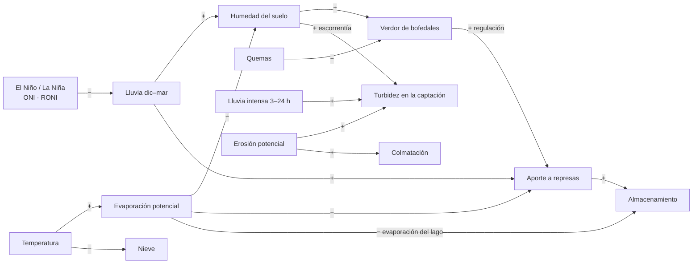

# Catálogo de variables e indicadores

> Todas las colecciones de esta tabla se verificaron en el catálogo oficial el 14-11-2026 ([informe](verificacion/README.md)), salvo donde se indica.
> **Unidad de análisis:** subcuenca de cada represa (incluidos los trasvases), polígono de bofedal o celda de producto. Toda variable se agrega a esa unidad con ponderación por área antes de calcular tendencias.

## 1. Variables

| Grupo | Variable | Símbolo y unidad | Producto principal | Resolución espacial / temporal | Periodo útil | Procesamiento | Relación física con el agua de Arequipa |
|---|---|---|---|---|---|---|---|
| Atmósfera | Lluvia | P, mm/mes | IMERG V07 Final (GPM_3IMERGM/DF) | 0,1° / mensual y diaria | 1998-01 → 2025-09 | Suma por mes; agregación por subcuenca; anomalías respecto de la climatología mensual | Entrada principal del balance; la temporada dic–mar llena las represas |
| Atmósfera | Lluvia (familia independiente) | P, mm/mes | CHIRPS v3 (satélite IR + pluviómetros) | 0,05° / mensual | 1981 → | Igual que IMERG | Contraste para la prueba de independencia |
| Atmósfera | Lluvia casi en tiempo real | P, mm/30 min | IMERG Early y Late | 0,1° / 30 min | Vigente (~4 h y ~14 h de latencia) | Acumulados de 3, 6, 12 y 24 h | Disparador de huaicos y turbidez (solo anticipación, nunca tendencias) |
| Atmósfera | Temperatura del aire a 2 m | T, °C | MERRA-2 (M2TMNXSLV) vía POWER | 0,5° × 0,625° / mensual | 1980 → | Corrección por altitud con NASADEM (−6,5 °C/km, con sensibilidad de 5,5 y 7,5) | Controla la evaporación, la fusión de nieve y la demanda de las plantas |
| Atmósfera | Radiación solar en superficie | Rs, MJ m⁻² día⁻¹ | POWER (CERES SYN1deg / SRB) | 0,5°–1° / mensual | 1984 → | Media mensual | Energía para la evaporación de embalses (Penman) |
| Atmósfera | Humedad relativa y viento a 2 m | HR, %; u₂, m/s | POWER / MERRA-2 | 0,5° / mensual | 1981 → | Media mensual | Términos aerodinámicos de la evaporación |
| Atmósfera | El Niño-Oscilación del Sur | ONI y RONI, °C; Niño3.4 | NOAA CPC; KNMI (ERSST v5) | Índice / mensual | 1950 → (ONI) | Promedios de tres meses; desfases de 0 a 3 meses | Principal modulador de la lluvia interanual en los Andes del sur |
| Superficie | Temperatura de superficie | LST, K | MOD11A2 y MYD11A2; VNP21A1D | 1 km / 8 días y diaria | 2000 → (MODIS), 2012 → (VIIRS) | Filtro de calidad (QC), compuesto mensual, día y noche por separado | Calentamiento de la superficie; corroboración física de la tendencia de T |
| Superficie | Vegetación | NDVI y EVI, adimensional | MOD13Q1 (250 m); VNP13A1 (500 m); HLS (30 m) | 250 m–30 m / 16 días | 2000 → (MODIS), 2013 → (HLS) | Máscara de nubes y calidad; mediana de la época seca (jun–sep) | Estado de los bofedales (la "esponja") |
| Superficie | Índice de condición de la vegetación | VCI, % | Derivado del NDVI (Kogan, 1995) | Igual que el NDVI | 2000 → | `VCI = (NDVI − NDVImín) / (NDVImáx − NDVImín)` por mes calendario | Estrés hídrico de la vegetación |
| Superficie | Evapotranspiración real | ET, mm/8 días | MOD16A2GF | 500 m / 8 días | 2000 → 2025-12 (publicación anual) | Suma mensual; filtro de calidad | Salida de agua del balance |
| Superficie | Nieve | Fracción de nieve, % | MOD10A1F; VNP10A1F | 500 m / 375 m, diaria | 2000 →; 2012 → | NDSI con relleno sin nubes; fracción de nieve por banda de altitud; altura de la línea de nieve | Indicador de calentamiento en los volcanes (no de volumen) |
| Suelo | Humedad del suelo superficial | θ, m³/m³ | SMAP SPL3SMP_E | 9 km / diaria | 2015-03 → | Media mensual; anomalías | Condición previa a los huaicos; estado de la esponja |
| Suelo | Humedad en la zona de raíces | θ_rz, m³/m³ | SMAP SPL4SMGP | 9 km / 3 h | 2015-03 → | Media diaria y mensual | Memoria hídrica de la cuenca |
| Suelo | Escorrentía y humedad (modelo) | Q y SM, kg/m² | GLDAS 2.1 / 2.0; FLDAS (forzado con CHIRPS) | 0,25° y 0,1° / mensual | 1948 → (GLDAS 2.0 hasta 2014) | Media por subcuenca | Contraste del gemelo hidrológico (no cierra el balance, ver I6) |
| Agua superficial | Superficie de agua | A, km² | HLS (MNDWI); Sentinel-2; Sentinel-1 (radar, con nubes); Landsat C2 | 30 m / 2–16 días | 1984 → (Landsat), 2013 → (HLS) | MNDWI con umbral de Otsu dentro del polígono máximo; radar con umbral de retrodispersión | Almacenamiento y colmatación de las represas |
| Agua superficial | Altura y cambio de almacenamiento | h, m; ΔS, hm³ | SWOT LakeSP versión D; ICESat-2 ATL13 | Por pasada / ~21 días (SWOT) | 2022-12 → (SWOT), 2018-10 → (ICESat-2) | Filtro de calidad; series por represa | Cambio de volumen observado para calibrar el modelo |
| Terreno | Elevación, pendiente y drenaje | z, m; pendiente, °; acumulación de flujo | NASADEM_HGT | 30 m / estático (2000) | — | Relleno de depresiones, dirección de flujo D8, acumulación | Corrección por altitud, conectividad, factor LS de la erosión |
| Perturbaciones | Fuego y área quemada | Fuegos activos; área quemada, ha | VNP14IMG; MCD64A1 | 375 m; 500 m / diaria y mensual | 2012 →; 2000 → | Conteo y área por subcuenca y mes | Quemas de pastizales que degradan bofedales y aumentan la erosión |
| Tierra (validación) | Lluvia y temperatura de estación | mm/día; °C | GHCN-Daily PE000084752 | Punto / diaria | Muy incompleta (ver verificación) | Solo años con al menos 90 % de días | Validación puntual |
| Tierra (validación) | Volumen, caudal afluente, descarga y lluvia por represa | hm³; m³/s; mm | Reportes de AUTODEMA | Represa / diaria | Archivo por confirmar | Digitalización verificada (sección 7b del diseño técnico) | Verdad terrestre del modelo de las represas |

## 2. Indicadores derivados

| Indicador | Definición | Uso | Referencia |
|---|---|---|---|
| **Anomalía desestacionalizada** | `x'(t) = x(t) − clim_m(t)` | Base de todas las tendencias | Práctica estándar (Wilks, 2011) |
| **Pendiente de Theil-Sen** | Mediana de las pendientes entre pares, por década, con IC al 90 % | Magnitud de la tendencia | Sen (1968) |
| **Mann-Kendall** (clásico y con corrección de Hamed-Rao) | Prueba de rango; se usa el **p mayor** de las dos variantes | Significancia | Mann (1945); Kendall (1975); Hamed y Rao (1998) |
| **Años para decidir** | `n* = [(3,3 σ/|ω|) · √((1+φ)/(1−φ))]^(2/3)` | Detectabilidad | Weatherhead et al. (1998) |
| **SPI y SPEI** (3, 6 y 12 meses) | Lluvia (SPI) o lluvia menos evapotranspiración potencial (SPEI), estandarizadas | Sequía meteorológica y su componente térmico | McKee et al. (1993); Vicente-Serrano et al. (2010) |
| **Índices de extremos ETCCDI** | Rx1day, Rx5day, R95pTOT, CDD | Lluvias extremas y rachas secas | Zhang et al. (2011) |
| **VCI** | Ver la tabla anterior | Estrés de vegetación | Kogan (1995) |
| **MNDWI** | `(Verde − SWIR1) / (Verde + SWIR1)` | Agua superficial | Xu (2006) |
| **Elasticidad de la escorrentía a la lluvia** | `ε_P = mediana((Q − Q̄)/(P − P̄) · P̄/Q̄)` | Sensibilidad del aporte a la lluvia (contraste de la atribución) | Sankarasubramanian et al. (2001) |
| **KGE** | `1 − √((r−1)² + (α−1)² + (β−1)²)` | Calidad del gemelo hidrológico | Gupta et al. (2009) |
| **CRPS y CRPSS** | Error de un pronóstico probabilístico frente a la climatología | Habilidad del pronóstico de temporada | Hersbach (2000) |
| **RUSLE (relativo)** | `A = R · K · LS · C · P` | Susceptibilidad a la erosión | Renard et al. (1997) |
| **Importancia por permutación con estabilidad** | Caída del desempeño fuera de muestra al barajar una variable, repetida con remuestreo | Matriz de Relevancia | Breiman (2001); Meinshausen y Bühlmann (2010) |

## 3. Relaciones científicas que el sistema pone a prueba

Cada flecha es una **hipótesis con signo esperado**. La Matriz de Relevancia comprueba si los datos la respaldan, con qué fuerza y con qué confianza. Una flecha que los datos no respaldan es un resultado, no un error.
