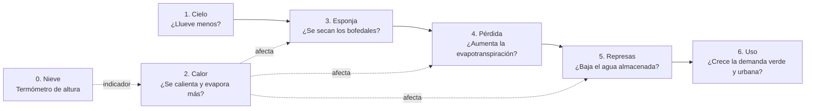
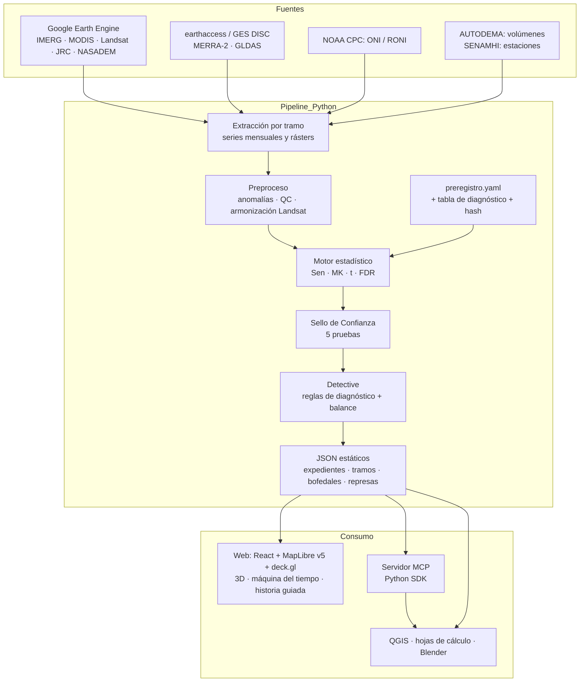

<div align="center">

# 🛰️ TerraVerdict

### *¿A dónde se va el agua de Arequipa?*
**Seguimos el agua tramo por tramo, del cielo a la represa y de la represa al caño. Te decimos en qué tramo está cambiando, qué hacer ahí y cuánto confiar en esa respuesta.**

[](https://www.spaceappschallenge.org/2026/challenges/earth-system-trend-detective/)
[](https://www.spaceappschallenge.org/2026/challenges/earth-system-trend-detective/)
[](#)
[](#10-datos-por-tramo)
[](#8-terraverdict-mcp-el-agua-de-arequipa-conversable)
[](#12-plan-para-las-48-horas)

</div>

---

## Índice

1. [Resumen en 30 segundos](#1-resumen-en-30-segundos)
2. [El problema real](#2-el-problema-real)
3. [Qué decisión cambia (y de quién)](#3-qué-decisión-cambia-y-de-quién)
4. [La Cadena del Agua](#4-la-cadena-del-agua)
5. [El detective: de tendencias a diagnóstico](#5-el-detective-de-tendencias-a-diagnóstico)
6. [Productos para actuar](#6-productos-para-actuar)
7. [Experiencia: Arequipa en 3D](#7-experiencia-arequipa-en-3d)
8. [TerraVerdict MCP: el agua de Arequipa, conversable](#8-terraverdict-mcp-el-agua-de-arequipa-conversable)
9. [El Sello de Confianza](#9-el-sello-de-confianza)
10. [Datos por tramo](#10-datos-por-tramo)
11. [Arquitectura](#11-arquitectura)
12. [Plan para las 48 horas](#12-plan-para-las-48-horas)
13. [Validación](#13-validación)
14. [Escala global](#14-escala-global)
15. [Limitaciones honestas](#15-limitaciones-honestas)
16. [Cómo cubre el reto y los criterios](#16-cómo-cubre-el-reto-y-los-criterios)
17. [Estructura del repositorio y cómo ejecutar](#17-estructura-del-repositorio-y-cómo-ejecutar)
18. [Equipo](#18-equipo)
19. [Referencias, licencias y atribuciones](#19-referencias-licencias-y-atribuciones)

---

## 1. Resumen en 30 segundos

Arequipa es una ciudad en el desierto que vive del agua que baja de las alturas: la lluvia de verano cae en el altiplano, los **bofedales** la retienen como una esponja, las **represas** del sistema regulado del Chili la almacenan y, al final, la usan la ciudad, el campo y la industria. En los años secos, las represas bajan y la pregunta de siempre vuelve: *¿llega cada vez menos agua?, ¿y por qué?*

Hoy las herramientas analizan **una variable a la vez**. TerraVerdict analiza **la cadena completa**, con un dato satelital de NASA por tramo, y la convierte en un **diagnóstico**:

> "La lluvia no cambia, pero los bofedales pierden verdor y la superficie de las represas baja: **el agua se está perdiendo en la esponja**, no en el cielo."

Cada conclusión lleva un **Sello de Confianza** (cinco pruebas de robustez) y, cuando los datos no alcanzan, dice **cuántos años faltan para saberlo**. Además, TerraVerdict entrega tres cosas que se pueden usar el lunes:

1. 🟢 **Mapa de bofedales prioritarios**: dónde invertir primero el dinero de conservación de la cuenca.
2. 💧 **Cuenta de evaporación de las represas**: cuánta agua se va al aire desde los embalses, expresada en días de agua para la ciudad.
3. 🤖 **Servidor MCP abierto**: cualquier asistente de IA, QGIS o una hoja de cálculo puede preguntarle al sistema "¿cómo está el agua de Arequipa?" y recibir respuestas con número, fuente y sello, sin inventar nada.

---

## 2. El problema real

### 2.1 Una ciudad del desierto que depende de una cadena larga y frágil

- Arequipa se abastece del río Chili, regulado por un sistema de represas en la cabecera de la cuenca (El Pañe, Dique de los Españoles, Pillones, Chalhuanca, Bamputañe, El Frayle y Aguada Blanca), operado por **AUTODEMA**. *(Lista y capacidades por confirmar con AUTODEMA.)*
- Parte de ese sistema **trasvasa agua desde cabeceras vecinas**, así que la "cuenca" que alimenta a la ciudad no es solo la cuenca topográfica del Chili. **El polígono de análisis debe incluir las áreas de aporte de los trasvases**. Es un error frecuente que TerraVerdict corrige desde la configuración.
- Gran parte de la cabecera está dentro de la **Reserva Nacional de Salinas y Aguada Blanca**, donde los **bofedales** regulan el agua que llega a las represas en la época seca.

### 2.2 Se decide con pocos datos y mucha discusión

- La falta de datos hidrométricos y meteorológicos es el mayor problema para estudiar y evaluar los recursos hídricos en las cuencas Camaná, Majes, Sihuas y Quilca-Vítor-Chili ([estudio hidrológico con información satelital](https://core.ac.uk/download/482041099.pdf)).
- Solo tres estaciones de caudal en Arequipa tienen registros de más de 20 años y siguen activas, con muchos datos faltantes y flujos alterados por la regulación ([Purdue / Arequipa Nexus](https://ag.purdue.edu/hydrology/swm/es/documents/datos_descarga_rios.pdf)).
- Las afirmaciones sobre la sequía se disputan públicamente: en una temporada, el Ministerio de Agricultura negó la escasez que SENAMHI advertía para Arequipa ([Proactivo](https://proactivo.com.pe/?p=33591)).

### 2.3 Hay dinero para actuar, pero no hay mapa de dónde actuar

La Ley 30215 creó los **Mecanismos de Retribución por Servicios Ecosistémicos (MERESE)**, y SUNASS los incorpora en las tarifas de las empresas de agua: una parte de lo que pagan los usuarios va a conservar y recuperar la cabecera de cuenca. La pregunta práctica es: **¿qué bofedal, qué ladera, qué tramo primero?** Hoy esa priorización casi no usa la historia satelital de 40 años que está disponible gratis. *(Monto y estado de ejecución del MERESE de SEDAPAR: por confirmar con SUNASS y SEDAPAR.)*

### 2.4 El problema científico de fondo (el del reto)

Una tendencia de 25 años puede ser ruido: depende del año de inicio, de la secuencia de El Niño y La Niña o de un cambio de satélite ([climate.gov](https://climate.gov/comment/2959), [Jonaitis et al., 2021](https://geo.appstate.edu/sites/default/files/jonaitis_etal_2021_ijoc.pdf), [NCAR/GDEX](https://gdex.ucar.edu/datasets/d731000/)). Si un gestor invierte según una tendencia falsa, pierde dinero y tiempo. Por eso cada tramo pasa por el **Sello de Confianza** antes de entrar al diagnóstico.

---

## 3. Qué decisión cambia (y de quién)

Una herramienta no resuelve la escasez de agua. Lo que sí puede hacer es **cambiar una decisión concreta, tomada por alguien concreto, en un momento concreto**. Estas son las decisiones que TerraVerdict apunta a mejorar:

| Actor | Decisión real | Cuándo | Qué le entrega TerraVerdict |
|---|---|---|---|
| **SEDAPAR / SUNASS** (MERESE) | En qué zonas de la cabecera invertir el fondo de conservación | Planificación anual | **Mapa de bofedales prioritarios** con tendencia, sello y área aguas arriba de cada represa |
| **AUTODEMA** | Cómo operar el sistema y qué esperar de la temporada de lluvias | Antes y durante la temporada (dic–mar) | Estado de la superficie de cada represa frente a su historia desde 1984 y **cuenta de evaporación** |
| **ANA / Junta de usuarios del Chili** | Cuánta agua se distribuye en la época seca y a quién | Al cierre de la temporada de lluvias | Diagnóstico de la cadena: si el problema es de oferta (cielo), de pérdida (calor, esponja) o de uso |
| **SENAMHI Arequipa** | Dónde instalar o reactivar estaciones | Planificación de red | **Mapa de "no decidible"**: dónde una estación reduciría más la incertidumbre ("faltan X años") |
| **Periodistas y público** | Creer o no una afirmación sobre la sequía | Cuando aparece la noticia | **Verificador**: Respaldada / Contradicha / No decidible, con la causa |
| **Estudiantes y docentes** *(público del reto)* | Entender el agua de su ciudad con datos reales | En clase | Historia guiada en 3D y casos del detective |

> **Cómo mediremos el impacto:** no por "usuarios registrados", sino por **una decisión que use el mapa o el diagnóstico**. Meta para después del hackathon: presentar el mapa de bofedales prioritarios a SEDAPAR o a la jefatura de la Reserva y obtener una carta de interés.

---

## 4. La Cadena del Agua

El agua de Arequipa recorre siete tramos. Cada tramo tiene una pregunta, un dato y un semáforo.



| # | Tramo | Pregunta | Dato principal | Contraste |
|---|---|---|---|---|
| 1 | ☁️ **Cielo** | ¿Llueve menos en la cabecera? | GPM IMERG V07 (mensual, 0.1°) | MERRA-2, PISCOp |
| 2 | 🌡️ **Calor** | ¿Se calienta la superficie? | MODIS LST (MOD11A2, 1 km) | MERRA-2 temperatura a 2 m |
| 3 | 🌱 **Esponja** | ¿Pierden verdor los bofedales en época seca? | Landsat NDVI de época seca (30 m, desde 1984) | MODIS NDVI (MOD13Q1, 250 m), SMAP |
| 4 | 💨 **Pérdida** | ¿Aumenta la evapotranspiración? | MODIS ET (MOD16A2, 500 m) | GLDAS-2.1 Noah |
| 5 | 🏞️ **Represas** | ¿Se reduce la superficie de agua? | Landsat (JRC Global Surface Water desde 1984 + Landsat/HLS reciente) | Volúmenes publicados por AUTODEMA |
| 6 | 🏙️ **Uso** | ¿Crece el área regada y la ciudad sobre la campiña? | Landsat NDVI y superficie construida | — |
| 0 | ❄️ **Nieve** | ¿Sube la línea de nieve en Chachani, Misti y Pichu Pichu? | MODIS nieve (MOD10A1, 500 m) | MODIS Aqua (MYD10A1) |

**Por qué la nieve es "tramo 0" y no una fuente principal.** En la cabecera del Chili casi no quedan glaciares y la nieve de los volcanes es estacional; el grueso del agua viene de la lluvia de verano en el altiplano *(a confirmar con la literatura de la cuenca)*. Por eso usamos la nieve como **termómetro de altura**: es la parte más visible del calentamiento y la mejor imagen para el público, pero no la contamos como un tramo de volumen.

**Por qué agregamos el tramo "Uso".** La pregunta es *a dónde se va el agua*. Sin mirar el final de la cadena, una represa que baja puede deberse a más consumo y no a menos lluvia. Landsat muestra cómo cambiaron el área regada y la ciudad sobre la campiña desde los años 80.

### Alcance del MVP de 48 horas

**Cuatro tramos y una represa:** Cielo (IMERG), Calor (MODIS LST), Esponja (NDVI de bofedales), Nieve (MODIS) como termómetro, y la superficie de **una represa** (El Frayle o El Pañe) con Landsat desde 1984. Los tramos Pérdida y Uso quedan como capas listas en la arquitectura y entran en la Fase 1.

---

## 5. El detective: de tendencias a diagnóstico

### 5.1 Las reglas de diagnóstico (preregistradas)

El detective no adivina: compara los semáforos de los tramos con una tabla de patrones escrita **antes** de mirar los datos. El hash SHA-256 de la tabla aparece en cada veredicto.

| Cielo | Calor / ET | Esponja | Represas | Diagnóstico | Dónde actuar |
|---|---|---|---|---|---|
| ↓ robusta | = | ↓ | ↓ | **Llega menos agua del cielo** | Almacenamiento, gestión de demanda, planes de sequía |
| = | ↑ robusta | ↓ | ↓ | **El agua se pierde por calor antes de llegar** | Proteger bofedales, reducir evaporación de embalses |
| = | = | ↓ robusta | ↓ | **La esponja se degrada** (pastoreo, drenaje, erosión) | Restauración de bofedales con fondos MERESE |
| = | = | = | ↓ | **El agua llega, pero se usa o se pierde abajo** | Eficiencia de riego, fugas, control de la demanda |
| ⚪ | ⚪ | ⚪ | ⚪ | **Todavía no se puede saber** | Medir: dónde instalar estaciones y cuántos años faltan |

*(↓ = tendencia a la baja con Sello de Confianza; = = sin tendencia detectable; ⚪ = no decidible.)*

**Honestidad del diagnóstico.** El patrón es **compatible** con una causa, no la demuestra. El veredicto se redacta así: *"Los datos son compatibles con que el agua se pierde en el tramo de calor; ninguna otra combinación de la tabla los explica mejor"*. Y si la combinación no está en la tabla, el sistema lo dice en vez de forzar un diagnóstico.

### 5.2 Prueba de coherencia: el balance de agua

Lluvia, evapotranspiración, salida de agua y cambio de almacenamiento deben cuadrar: **P − ET − Q ≈ ΔS**. Si no cuadran, alguno de los datos está mal y el sistema avisa.

> ⚠️ **Trampa que evitamos:** GLDAS es un modelo que cierra su propio balance por construcción. Usar lluvia, ET y escorrentía **todas de GLDAS** daría un balance perfecto que no prueba nada. Por eso el balance combina **fuentes independientes**: P de IMERG, ET de MODIS, ΔS de la superficie de las represas (Landsat) y Q de las descargas que publica AUTODEMA. Es la misma lógica de la genealogía de datos del Sello de Confianza.

### 5.3 Cuando un tramo es "no decidible": buscar la serie más larga

MODIS tiene unos 25 años, y muchas veces no alcanza para decidir. Landsat tiene archivo desde 1984. Si un tramo sale "no decidible" con MODIS y existe una variable equivalente en Landsat (verdor de bofedales, superficie de agua, área urbana), el detective **repite la prueba con la serie larga** y lo indica en el veredicto.

---

## 6. Productos para actuar

### 6.1 🟢 Mapa de bofedales prioritarios (el producto estrella)

Los bofedales se distinguen desde el espacio porque **siguen verdes en la época seca** (jun–sep), cuando el resto del altiplano está pardo. Con Landsat:

1. **Mapear** bofedales: píxeles con NDVI de época seca alto y pendiente baja (NASADEM).
2. **Medir su tendencia** desde 1984: pendiente de Sen del NDVI de época seca por bofedal, con Sello de Confianza.
3. **Ponderar su importancia**: área del bofedal y si está **aguas arriba de una represa** del sistema.
4. **Priorizar**: `prioridad = degradación robusta × área × aporte a represa`.

Salida: lista ordenada, mapa en 3D y archivo GeoJSON que se abre en QGIS. Es lo que una oficina de MERESE o la jefatura de la Reserva necesita para decidir dónde ir primero.

### 6.2 💧 Cuenta de evaporación de las represas

A más de 4000 m, con radiación intensa y viento, un embalse pierde agua directamente al aire. TerraVerdict estima:

`evaporación (hm³/mes) = superficie de agua (Landsat) × evaporación de agua libre (Penman con radiación, temperatura, humedad y viento de MERRA-2)`

y la traduce a una unidad que todos entienden: **"días de agua para la ciudad"** *(consumo de referencia por confirmar con SEDAPAR)*. Es una estimación y se presenta con su rango; sirve para comparar con alternativas como coberturas o una operación que reduzca la superficie expuesta.

### 6.3 ⚖️ Veredicto de la cadena y verificador

Una tarjeta para compartir con el diagnóstico, los semáforos de los tramos, el sello de cada uno y un código QR al expediente reproducible.

### 6.4 📍 Mapa de "dónde medir"

Donde un tramo es "no decidible" y no hay estaciones cerca, se marca como prioridad de monitoreo con los **años que faltan para decidir**.

### 6.5 🌦️ Panorama de temporada *(stretch, si alcanza el tiempo)*

En noviembre empieza la pregunta "¿se llenarán las represas este año?". Con la lluvia acumulada de la temporada (IMERG Late Run) y el estado de ENSO, se buscan los **años análogos** de la historia y se muestra el rango de llenado que tuvieron esas represas. Es un método simple y transparente; no es un pronóstico hidrológico y así se presenta.

---

## 7. Experiencia: Arequipa en 3D

### 7.1 La escena

- **Terreno real en 3D** de la cuenca con los volcanes Chachani, Misti y Pichu Pichu, desde **NASADEM** (30 m), sobre MapLibre GL JS v5 y con exageración vertical ajustable.
- **El agua que baja:** partículas animadas que recorren la red de ríos (HydroRIVERS) desde las cumbres hasta las represas y la ciudad, con `TripsLayer` de deck.gl. La **densidad** de partículas sigue el caudal relativo y el **color** sigue el semáforo de cada tramo.
- **Represas que se llenan:** cada embalse se dibuja con su contorno histórico máximo y su superficie del mes elegido; al mover la línea de tiempo, el agua sube o baja.
- **Bofedales que respiran:** manchas verdes que se apagan o se intensifican según su tendencia, con paletas que suprimen la incertidumbre (VSUP, [Correll et al., 2018](https://www.tableau.com/research/publications/value-suppressing-uncertainty-palettes)): lo frágil se ve apagado y lo robusto se ve intenso.

### 7.2 La máquina del tiempo

Un deslizador que compara **imágenes satelitales reales** de dos años: la nieve del Chachani, la superficie de El Frayle o la campiña de Arequipa en 1985 frente a hoy (Landsat, color natural).

### 7.3 La historia guiada (*scrollytelling*)

La cámara viaja por la cuenca mientras el usuario hace scroll:

1. **El cielo** → la cámara sube a las nubes del altiplano: ¿llueve menos?
2. **La nieve** → acercamiento al Chachani con la máquina del tiempo.
3. **La esponja** → vuelo bajo sobre los bofedales de la Reserva.
4. **La represa** → el embalse sube y baja de 1984 a hoy.
5. **El veredicto** → la cadena se ilumina y aparece la frase final:
   *"El agua se está perdiendo en el tramo de calor"* o *"Todavía no se puede saber: faltan ~X años de datos"*.

### 7.4 Accesibilidad

Bilingüe ES/EN · paletas aptas para daltonismo · funciona en celular · modo ligero sin 3D · glosario en cada término técnico.

---

## 8. TerraVerdict MCP: el agua de Arequipa, conversable

El [Model Context Protocol (MCP)](https://modelcontextprotocol.io) es un estándar abierto para que asistentes de IA y otros programas usen herramientas externas. TerraVerdict publica un **servidor MCP** que expone sus resultados precalculados. Así, cualquier cliente compatible (Claude, otros asistentes, editores de código o agentes propios) puede consultar el estado del agua de Arequipa.

### 8.1 Herramientas del servidor

| Herramienta | Qué devuelve |
|---|---|
| `estado_cadena(cuenca)` | Semáforo, tendencia y sello de cada tramo, más el diagnóstico |
| `tramo(cuenca, tramo, desde, hasta)` | Serie, pendiente de Sen con IC, prueba de Mann-Kendall, sello y años para decidir |
| `represas(cuenca)` | Superficie actual de cada represa frente a su historia y evaporación estimada |
| `bofedales_prioritarios(cuenca, n)` | Los *n* bofedales con mayor prioridad, en GeoJSON |
| `verificar_afirmacion(variable, region, desde, hasta, sentido)` | Respaldada / Contradicha / No decidible, con la causa |
| `expediente(id)` | El JSON reproducible de cualquier resultado |

### 8.2 Regla de oro: la IA conversa, pero no calcula

El núcleo sigue siendo estadística transparente y reproducible. El modelo de lenguaje solo **traduce la pregunta** y **redacta la respuesta**; cada número que aparece en la respuesta viene de una herramienta y **cita su ID de expediente**. Si la herramienta dice "no decidible", el asistente no puede decir otra cosa.

```text
Usuario:  ¿Es verdad que en Arequipa llueve cada vez menos?
Asistente → verificar_afirmacion("precipitacion", "chili_regulado", 2001, 2025, "baja")
Asistente: No se puede afirmar todavía. La lluvia en la cabecera muestra una pendiente
           de ±X mm/mes por década, pero no pasa la prueba de ventanas ni el filtro ENSO.
           Con la variabilidad actual faltarían ~X años para decidir. [Expediente TV-CHILI-0003]
```
*(Valores ilustrativos de formato: ningún número de este README es un resultado calculado.)*

### 8.3 Conexión con otros programas

| Programa | Cómo se conecta | Para qué |
|---|---|---|
| **Asistentes de IA con MCP** | Servidor TerraVerdict MCP (stdio o HTTP) | Preguntas en lenguaje natural de periodistas, docentes y gestores |
| **QGIS** | GeoJSON y COG que exporta TerraVerdict; servidores MCP comunitarios para QGIS *(evaluar)* | El técnico de AUTODEMA o de la Reserva abre el mapa de bofedales en su herramienta de siempre |
| **Hojas de cálculo** | Export CSV y conectores MCP de hojas de cálculo | Reporte mensual de represas sin programar |
| **Blender** | Servidor MCP comunitario de Blender *(evaluar)* + NASADEM | Render cinematográfico de la cuenca para el video del pitch |
| **Google Earth Engine** | Scripts de extracción del pipeline | Reprocesar la cuenca o cambiar de ciudad |

El servidor MCP **no necesita base de datos**: lee los mismos JSON estáticos que usa la web.

---

## 9. El Sello de Confianza

Todo el rigor del diseño original se conserva como el **sello** que acompaña a cada tramo. Una tendencia solo entra al diagnóstico si lo pasa.

| # | Prueba | Pregunta | Qué se calcula |
|---|---|---|---|
| 1 | **Ventanas** | ¿Depende del año de inicio o fin? | Tendencia para todas las ventanas con longitud mínima preregistrada; % que confirma el signo |
| 2 | **Filtro ENSO** | ¿Es solo la secuencia de El Niño y La Niña? | `anomalía(t) = a + b·t + Σₖ cₖ·ONI(t−k) + ε(t)`, rezagos 0–3 meses; se repite con RONI |
| 3 | **Sensor** | ¿Es un escalón del instrumento? | Modelo con escalón en transiciones documentadas (TRMM→GPM en junio de 2014; Landsat 5→7→8→9) |
| 4 | **Independencia** | ¿Lo confirman fuentes que no comparten insumos? | Confirmaciones contadas por **familias** del grafo de procedencia, no por número de productos |
| 5 | **Detectabilidad** | ¿Hay suficientes datos? | Tendencia mínima detectable y años para decidir (Weatherhead et al., 1998, y bootstrap por bloques) |

**Núcleo estadístico:** anomalías desestacionalizadas · pendiente de Theil-Sen por década con IC 95 % · Mann-Kendall con corrección por autocorrelación (Hamed-Rao) · t-test con tamaño muestral efectivo · control FDR de Benjamini-Hochberg en mapas.

**Veredictos por tramo:** 🟢 Robusta · 🟡 Frágil (se indica qué prueba falla) · ⚪ No decidible (con años para decidir) · 🔵 Sin tendencia detectable.

**Preregistro sellado:** los parámetros del análisis y la tabla de diagnóstico se guardan en `config/preregistro.yaml` y su hash SHA-256 aparece en cada veredicto.

**Genealogía de datos (ejemplos verificados):**

| Producto | Insumos documentados |
|---|---|
| IMERG Final Run | Satélites + ajuste mensual con pluviómetros **GPCC** ([NASA GPM](https://gpm.nasa.gov/taxonomy/term/1417)) |
| GLDAS-2.1 Noah | Forzado con **GDAS**, **GPCP** y radiación **AGRMET** ([GES DISC](https://www.earthdata.nasa.gov/fr/data/catalog/ges-disc-gldas-noah025-m-2.1)) |
| PISCOp V2.1 | Pluviómetros de SENAMHI + **CHIRP** ([SENAMHI](https://repositorio.senamhi.gob.pe/handle/20.500.12542/288)) |

---

## 10. Datos por tramo

> Los IDs de Google Earth Engine (GEE) permiten extraer todos los tramos con un solo script. **Verificar cada ID en el catálogo de GEE antes de correr.**

| Tramo | Producto | Resolución / periodo | ID en GEE | Restricción conocida |
|---|---|---|---|---|
| Cielo | GPM IMERG V07 Final (NASA/JAXA) | 0.1°, mensual, desde 2000 | `NASA/GPM_L3/IMERG_MONTHLY_V07` | Menor habilidad en terreno complejo; transición TRMM→GPM en 2014 |
| Cielo (contraste) | MERRA-2 (NASA GMAO) | ½° × ⅝°, desde 1980 | `NASA/GSFC/MERRA/slv/2` (y colecciones de flujos) | Reanálisis: modelo + observaciones |
| Calor | MODIS LST MOD11A2 v6.1 | 1 km, 8 días, desde 2000 | `MODIS/061/MOD11A2` | Nubes en temporada de lluvias |
| Esponja | Landsat 5/7/8/9 Collection 2 L2 (NASA/USGS) | 30 m, desde 1984 | `LANDSAT/LT05/C02/T1_L2`, `LE07`, `LC08`, `LC09` | Landsat 7 con bandas faltantes desde 2003; armonizar sensores |
| Esponja (contraste) | MODIS NDVI MOD13Q1 v6.1 | 250 m, 16 días, desde 2000 | `MODIS/061/MOD13Q1` | Bofedales pequeños se mezclan con el entorno |
| Esponja (contraste) | SMAP L3 | 9–36 km, desde 2015 | `NASA/SMAP/SPL3SMP_E/...` | Solo ~11 años: contraste, no tendencia |
| Pérdida | MODIS ET MOD16A2 v6.1 | 500 m, 8 días, desde 2001 | `MODIS/061/MOD16A2` | Producto de modelo con insumos MODIS y meteorología |
| Pérdida (contraste) | GLDAS-2.1 Noah | 0.25°, desde 2000 | `NASA/GLDAS/V021/NOAH/G025/T3H` | Modelo *open-loop*; no usar para cerrar el balance |
| Represas | JRC Global Surface Water (derivado de Landsat) | 30 m, mensual, 1984–2021 | `JRC/GSW1_4/MonthlyHistory` | Termina en 2021: se completa con Landsat/HLS |
| Represas (reciente) | HLS L30/S30 (NASA) | 30 m, desde 2013 | `NASA/HLS/HLSL30/v002` | Combinar con índice de agua (MNDWI) |
| Represas (verdad terrestre) | Volúmenes del sistema Chili regulado (AUTODEMA) | Diario | Fuente local, por conseguir | Disponibilidad histórica por confirmar |
| Nieve | MODIS MOD10A1 v6.1 | 500 m, diaria, desde 2000 | `MODIS/061/MOD10A1` | Nubes; nieve fina o efímera puede no detectarse |
| Terreno 3D | NASADEM (NASA) | 30 m, global | `NASA/NASADEM_HGT/001` | Elevación de la misión SRTM reprocesada |
| Ríos | HydroRIVERS (HydroSHEDS) | Vectorial, global | Descarga directa | Solo para la animación |
| ENSO | ONI y RONI (NOAA CPC) | Mensual desde 1950 | [CPC](https://cpc.ncep.noaa.gov/data/indices/) | No es dato NASA; desde 2026 NOAA usa RONI |
| Base visual | NASA GIBS | WMTS | — | Solo visual |

**Cambio respecto al diseño anterior:** el terreno pasa de Copernicus DEM a **NASADEM**, para que todo el núcleo visual y analítico use datos NASA. Copernicus DEM queda como alternativa.

**Fuera del MVP, con motivo:** NISAR (sin historia suficiente), GRACE/GRACE-FO (~300 km, demasiado grueso para la cuenca) y FIRMS (fuera del foco). Giovanni y Worldview se usan para validar y para mostrar.

---

## 11. Arquitectura



| Capa | Tecnología | Motivo |
|---|---|---|
| Extracción | Google Earth Engine (Python API), `earthaccess` | Todos los tramos en un script; sin descargar terabytes |
| Procesamiento | Python, `xarray`, `numpy`, `scipy`, `statsmodels`, `pymannkendall` | Estándar científico abierto |
| Salidas | JSON, GeoJSON, Cloud-Optimized GeoTIFF | Sitio estático, sin base de datos |
| Web | React + TypeScript + Vite, MapLibre GL JS v5, deck.gl (`TripsLayer`, `MapboxOverlay`), Observable Plot | Abierto, 3D, sin claves de pago |
| MCP | SDK oficial de MCP para Python (`FastMCP`) | ~150 líneas sobre los mismos JSON |
| Reproducibilidad | Preregistro con hash, DOIs de datos y notebooks | Auditabilidad |

---

## 12. Plan para las 48 horas

**Regla del equipo:** primero un resultado verdadero de punta a punta con un tramo; después se agregan tramos. Si algo no llega, se muestra como "en camino", nunca con datos inventados.

| Bloque | Datos y motor | Web 3D | MCP e integración | Historia y pitch |
|---|---|---|---|---|
| **Día 1, mañana** | Polígono de la cuenca regulada (con trasvases) y de una represa; script GEE para IMERG y JRC | Escena MapLibre con NASADEM y volcanes | Esqueleto del servidor MCP con datos de prueba | Guion de la historia y frase del veredicto |
| **Día 1, tarde** | Series de MODIS LST, nieve y NDVI de época seca; anomalías y Sen + MK | Ríos animados con deck.gl; contorno de la represa por año | `estado_cadena` y `tramo` leyendo JSON reales | Capturas de la máquina del tiempo (Landsat 1985 frente a hoy) |
| **Día 1, noche** | Pruebas 1, 2 y 5 del sello; mapa de bofedales con Landsat | Semáforo de tramos y panel de veredicto | `bofedales_prioritarios` y export GeoJSON para QGIS | Borrador del video |
| **Día 2, mañana** | Reglas de diagnóstico y cuenta de evaporación | Historia guiada (*scrollytelling*) | Demo en vivo: pregunta en lenguaje natural → respuesta con expediente | Ensayo del pitch |
| **Día 2, tarde** | Congelar resultados y hash del preregistro | Pulido, celular y modo ligero | Instrucciones de instalación del MCP | Video final y README con resultados reales |

**Si el tiempo aprieta, se recorta en este orden:** panorama de temporada → tramo Uso → prueba de sensor → evaporación. **Nunca se recortan** el sello de confianza ni la honestidad del "no decidible".

---

## 13. Validación

| # | Validación | Cómo | Criterio de éxito |
|---|---|---|---|
| V1 | Exactitud del motor | Pruebas contra `pymannkendall`, `scipy` y series sintéticas | Coincidencia numérica |
| V2 | Calibración | Monte Carlo: AR(1) sin tendencia + forzamiento tipo ENSO | Falsos positivos del veredicto "Robusta" cerca de α |
| V3 | Represa: superficie frente a volumen | Superficie Landsat contra volúmenes de AUTODEMA | Relación monótona y estable (curva área-volumen) |
| V4 | Reproducción NASA | Series de área contra Giovanni para el mismo producto y región | Diferencia dentro de la tolerancia preregistrada |
| V5 | Bofedales | Mapa contra inventarios publicados de la Reserva o contra fotointerpretación de muestras | Exactitud reportada con su matriz de confusión |
| V6 | Balance de agua | P (IMERG) − ET (MODIS) − Q (AUTODEMA) frente a ΔS (Landsat) | Cierre dentro del error esperado; si no, alerta |
| V7 | Usabilidad | Prueba con estudiantes de la UNSA, antes y después | Mejor interpretación de tendencias y del "no decidible" |

---

## 14. Escala global

Muchas ciudades dependen del agua que baja de una montaña: **Lima, La Paz, El Alto, Santiago, Quito, Mendoza, Katmandú y las ciudades de Asia Central**. Todos los datos del núcleo son globales, así que replicarlo es cambiar un archivo:

```yaml
# config/cuencas/chili_regulado.yaml
nombre: Sistema regulado del Chili
ciudad: Arequipa
poligono: datos/cuencas/chili_regulado.geojson   # incluye áreas de trasvase
represas: [el_frayle, el_pane, pillones, aguada_blanca, chalhuanca, bamputane, dique_espanoles]
temporada_lluvias: [12, 1, 2, 3]
temporada_seca: [6, 7, 8, 9]
tramos: [cielo, calor, esponja, perdida, represas, uso, nieve]
```

> **Mensaje para el jurado:** *"Empezamos con el agua de Arequipa, y sirve para cualquier ciudad que depende de una montaña."*

El servidor MCP hace que la escala sea también **de uso**: un periodista de La Paz o un docente de Quito puede preguntarle a su asistente por su propia cuenca cuando esté configurada.

---

## 15. Limitaciones honestas

- **Correlación no es causa.** El diagnóstico dice qué causa es **compatible** con los datos, no la demuestra.
- **Series cortas.** Con ~25 años de MODIS e IMERG, muchos tramos saldrán "no decidibles". No lo escondemos: es información útil (dónde medir y cuántos años faltan), y Landsat extiende la historia donde puede.
- **Resolución.** IMERG (0.1°) es grueso para la cabecera andina; IMERG tiene errores sistemáticos en zonas áridas y de montaña ([Manz et al., 2017](https://redi.cedia.edu.ec/document/86400)).
- **La represa la opera una persona.** La superficie de un embalse refleja lluvia **y** decisiones de operación. Por eso se valida con los volúmenes y descargas de AUTODEMA.
- **Armonización de Landsat.** Los sensores TM, ETM+, OLI y OLI-2 difieren; se armonizan y la prueba de sensor revisa los saltos en cada transición.
- **Evaporación estimada.** Depende de la fórmula y de MERRA-2; se presenta con rango.
- **Datos locales.** El acceso a series históricas de AUTODEMA y SENAMHI no está garantizado; V3 y V6 dependen de ello.

---

## 16. Cómo cubre el reto y los criterios

| Objetivo del reto | Cómo lo resuelve TerraVerdict |
|---|---|
| 1. Identificar variables de interés | **El recorrido del agua elige las variables**, no el azar: cada tramo tiene una pregunta y un dato |
| 2. Obtener datos para una región | Cuenca regulada del Chili (con trasvases), represas y bofedales; cualquier cuenca por configuración |
| 3. Visualizar la serie temporal | Series por tramo, 3D animado, máquina del tiempo e historia guiada |
| 4. Tasa de cambio y significancia | Sen por década con IC, Mann-Kendall corregido y t-test, más el Sello de Confianza |
| "Una tendencia no significativa también es interesante" | "Años para decidir" y mapa de dónde medir |
| "La misma variable puede tender en sentidos opuestos" | Los tramos se comparan entre sí: la lluvia puede no cambiar mientras la esponja se seca |

| Criterio | Apuesta |
|---|---|
| **Impacto** | Decisiones concretas de SEDAPAR, AUTODEMA, ANA y SENAMHI; mapa de bofedales para el fondo MERESE |
| **Creatividad** | La cadena de tendencias, el detective con reglas preregistradas y el servidor MCP |
| **Validez** | Sello de 5 pruebas, balance con fuentes independientes y validación con represas reales |
| **Pertinencia** | Cubre los 4 objetivos del reto y sus consideraciones opcionales |
| **Presentación** | Historia en 3D: el agua baja de los volcanes y la cadena se ilumina hasta el veredicto |

**Premios a los que apunta:** Impacto Local · Mejor Uso de los Datos · Mejor Uso de la Ciencia · Conexión Global.

---

## 17. Estructura del repositorio y cómo ejecutar

> 🚧 **Estado actual:** documento de diseño. La estructura y los comandos describen el plan de implementación.

```
terraverdict/
├── readme.md
├── config/
│   ├── preregistro.yaml          # parámetros + tabla de diagnóstico (se hashea)
│   └── cuencas/chili_regulado.yaml
├── datos/cuencas/                # polígonos de cuenca, represas y bofedales
├── pipeline/
│   ├── extraccion/               # scripts GEE y earthaccess por tramo
│   ├── preproceso/               # anomalías, QC, armonización Landsat
│   ├── motor/                    # sen, mk, ttest, fdr
│   ├── sello/                    # ventanas, enso, sensor, independencia, detectabilidad
│   ├── detective/                # reglas de diagnóstico y balance de agua
│   ├── productos/                # bofedales prioritarios, evaporación, dónde medir
│   └── exportar/                 # JSON, GeoJSON, COG
├── mcp/
│   └── servidor.py               # servidor MCP sobre los JSON exportados
├── web/                          # React + TS + MapLibre + deck.gl
│   └── src/{escena3d,cadena,maquina_tiempo,historia,veredicto,i18n}
├── notebooks/
└── tests/
```

```bash
pip install -r pipeline/requirements.txt
```

```bash
earthengine authenticate
```

```bash
python -m pipeline.run --cuenca config/cuencas/chili_regulado.yaml
```

```bash
cd web && npm install && npm run dev
```

```bash
python mcp/servidor.py
```

---

## 18. Equipo

| Integrante | Formación | Rol |
|---|---|---|
| Ower López | Ingeniería de Sistemas (UNSA) | Arquitectura, pipeline y servidor MCP |
| *[Nombre]* | Ingeniería de Sistemas, enfoque en datos | Motor estadístico, sello y validación |
| *[Nombre]* | Comunicación | Historia guiada, pitch y video |
| *[Nombre]* | *[Cupo flexible]* | Web 3D (MapLibre + deck.gl) |

---

## 19. Referencias, licencias y atribuciones

**Estadística y métodos**
- Benjamini, Y. y Hochberg, Y. (1995). Controlling the false discovery rate. *JRSS-B*.
- Hamed, K. H. y Rao, A. R. (1998). A modified Mann-Kendall trend test for autocorrelated data. *Journal of Hydrology*.
- Pettitt, A. N. (1979). A non-parametric approach to the change-point problem. *Applied Statistics*.
- Santer, B. D. et al. (2000). Statistical significance of trends and trend differences in layer-average atmospheric temperature time series. *JGR*.
- Sen, P. K. (1968). Estimates of the regression coefficient based on Kendall's tau. *JASA*.
- Weatherhead, E. C. et al. (1998). Factors affecting the detection of trends. *JGR*.
- Wilks, D. S. (2016). "The stippling shows statistically significant grid points". *BAMS*.
- Cortés, J. et al. (2021). Where are global vegetation greening and browning trends significant? *GRL*. [PDF](https://sites.bu.edu/cliveg/files/2021/03/Cortes-GRL-2021.pdf)

**Visualización**
- Correll, M., Moritz, D. y Heer, J. (2018). Value-Suppressing Uncertainty Palettes. *CHI 2018*. [Enlace](https://www.tableau.com/research/publications/value-suppressing-uncertainty-palettes)

**Clima, agua y datos de la región**
- Jonaitis, J. A. et al. (2021). Spatiotemporal patterns of ENSO-precipitation relationships in the tropical Andes of southern Peru and Bolivia. *Int. J. Climatology*. [PDF](https://geo.appstate.edu/sites/default/files/jonaitis_etal_2021_ijoc.pdf)
- Sulca, J., Vuille, M. y Dong, B. Interdecadal variability of the austral summer precipitation over the Central Andes. *Frontiers in Earth Science*. [PDF](https://www.frontiersin.org/journals/earth-science/articles/10.3389/feart.2022.954954/pdf)
- Manz, B. et al. (2017). Comparative ground validation of IMERG and TMPA in the tropical Andes. *J. Hydrometeorology*. [Enlace](https://redi.cedia.edu.ec/document/86400)
- Aybar, C. et al. (2020). Construction of a high-resolution gridded rainfall dataset for Peru from 1981 to the present day. *Hydrological Sciences Journal*. DOI [10.1080/02626667.2019.1649411](https://doi.org/10.1080/02626667.2019.1649411)
- Ley N.° 30215, Ley de Mecanismos de Retribución por Servicios Ecosistémicos (Perú, 2014).
- Pekel, J.-F. et al. (2016). High-resolution mapping of global surface water and its long-term changes. *Nature* 540, 418–422.

**Fichas de datos**
- GPM IMERG: https://gpm.nasa.gov/taxonomy/term/1417
- GLDAS-2.1 Noah mensual 0.25°: https://www.earthdata.nasa.gov/fr/data/catalog/ges-disc-gldas-noah025-m-2.1
- MOD10A1F v6.1: https://nsidc.org/data/MOD10A1F/versions/61
- SMAP SPL3SMP: https://nsidc.org/data/spl3smp/
- NASA POWER: https://power.larc.nasa.gov/docs/methodology/data/sources/
- Disponibilidad de NISAR: https://nisar-docs.asf.alaska.edu/availability-overview/
- Model Context Protocol: https://modelcontextprotocol.io

**Licencias y atribuciones**
- **Código:** MIT (propuesto).
- **Datos NASA y Landsat (NASA/USGS):** abiertos; se citan los DOIs en cada expediente.
- **JRC Global Surface Water:** © EC JRC/Google, citar Pekel et al. (2016).
- **PISCOp V2.1:** CC BY-NC-ND; solo para validación, sin redistribuir derivados.
- **HydroSHEDS / HydroRIVERS:** según su licencia, con atribución.
- **NASA GIBS:** "We acknowledge the use of imagery provided by services from NASA's Global Imagery Browse Services (GIBS), part of NASA's Earth Science Data and Information System (ESDIS)."
- **ONI / RONI:** NOAA Climate Prediction Center.

<div align="center">

---

**TerraVerdict** · NASA Space Apps Challenge 2026 · Arequipa, Perú
*El agua de Arequipa no se pierde de golpe: se pierde en un tramo. Nosotros lo encontramos.*

</div>
