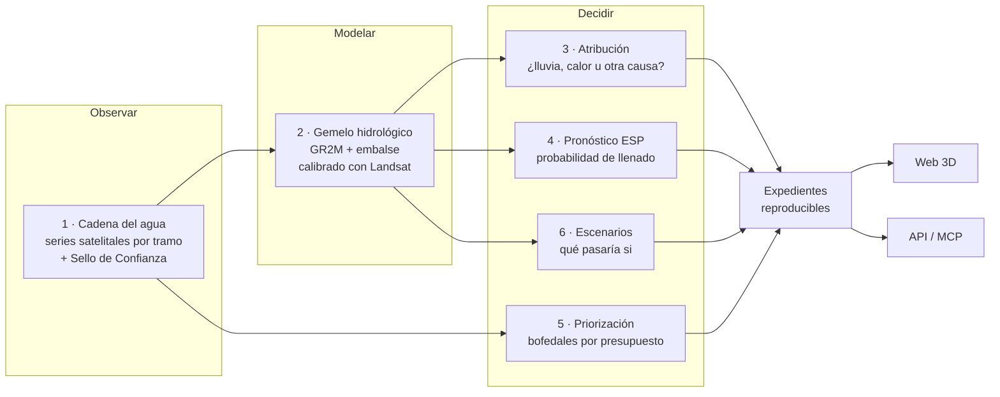
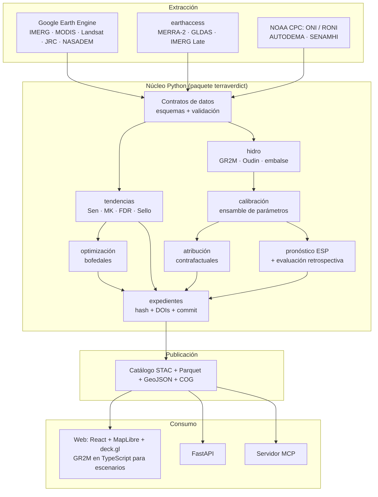

<div align="center">

# 🛰️ TerraVerdict

### *El gemelo digital del agua de Arequipa*
**Explica a dónde se va el agua, pronostica cuánta habrá y dice dónde actuar primero. Todo con datos de NASA, un modelo hidrológico calibrado desde el espacio y una medida honesta de cuánto confiar en cada respuesta.**

[](https://www.spaceappschallenge.org/2026/challenges/earth-system-trend-detective/)
[](https://www.spaceappschallenge.org/2026/challenges/earth-system-trend-detective/)
[](#)
[](#9-datos)
[](#7-api-y-servidor-mcp)
[](docs/diseno-tecnico.md)

</div>

---

## Índice

1. [Resumen en 30 segundos](#1-resumen-en-30-segundos)
2. [El problema y las decisiones que cambia](#2-el-problema-y-las-decisiones-que-cambia)
3. [De la idea base a un sistema de decisión](#3-de-la-idea-base-a-un-sistema-de-decisión)
4. [Cómo funciona: seis motores](#4-cómo-funciona-seis-motores)
5. [Las tres preguntas que responde](#5-las-tres-preguntas-que-responde)
6. [Experiencia: Arequipa en 3D](#6-experiencia-arequipa-en-3d)
7. [API y servidor MCP](#7-api-y-servidor-mcp)
8. [Arquitectura](#8-arquitectura)
9. [Datos](#9-datos)
10. [Evaluación: cómo sabemos que funciona](#10-evaluación-cómo-sabemos-que-funciona)
11. [Plan para las 48 horas](#11-plan-para-las-48-horas)
12. [Escala global](#12-escala-global)
13. [Limitaciones y riesgos](#13-limitaciones-y-riesgos)
14. [Cómo cubre el reto y los criterios](#14-cómo-cubre-el-reto-y-los-criterios)
15. [Repositorio y ejecución](#15-repositorio-y-ejecución)
16. [Equipo](#16-equipo)
17. [Referencias y licencias](#17-referencias-y-licencias)

📐 **El diseño técnico completo (ecuaciones, contratos de datos, decisiones de arquitectura, pruebas y riesgos) está en [`docs/diseno-tecnico.md`](docs/diseno-tecnico.md).**

---

## 1. Resumen en 30 segundos

Arequipa es una ciudad del desierto que vive del agua que cae en el altiplano. Los **bofedales** la retienen, las **represas** del sistema regulado del Chili la guardan y la ciudad, el campo y la industria la usan. Cada año se repiten tres preguntas que hoy se responden con pocos datos y mucha discusión:

| Pregunta | Qué entrega TerraVerdict | Cómo |
|---|---|---|
| **¿A dónde se va el agua?** | Qué parte del cambio en el agua que llega a las represas se debe a **menos lluvia**, a **más calor** o a **otras causas** (uso, operación, degradación de la cuenca) | **Atribución contrafactual** con un modelo hidrológico calibrado con satélites |
| **¿Cuánta agua tendremos?** | La **probabilidad** de que las represas terminen la temporada de lluvias por debajo de un umbral | **Pronóstico por ensambles (ESP)** condicionado por El Niño y La Niña, validado contra 20 años de pronósticos retrospectivos |
| **¿Dónde actuar primero?** | Un **ranking de bofedales** para invertir el fondo de conservación de la cuenca, y **simulaciones** de "qué pasaría si" | Landsat desde 1984, red de drenaje desde NASADEM y optimización por presupuesto |

Cada número sale con su **Sello de Confianza**: pruebas de robustez y, cuando los datos no alcanzan, **cuántos años faltan para saberlo**. Si el pronóstico no le gana a la climatología, el sistema **no lo publica** y lo dice.

> **La frase para el jurado:** *"Las herramientas de hoy te muestran si una variable cambia. TerraVerdict te dice por qué cambia el agua de tu ciudad, cuánta tendrás y dónde invertir, y te avisa cuándo todavía no se sabe."*

---

## 2. El problema y las decisiones que cambia

### 2.1 El sistema real

- Arequipa depende del río Chili, regulado por un sistema de represas de cabecera (El Pañe, Dique de los Españoles, Pillones, Chalhuanca, Bamputañe, El Frayle y Aguada Blanca) operado por **AUTODEMA**, con **trasvases** desde cabeceras vecinas. *(Lista, capacidades y trasvases por confirmar con AUTODEMA.)*
- Gran parte de la cabecera está en la **Reserva Nacional de Salinas y Aguada Blanca**, donde los bofedales sostienen el agua en la época seca.
- La Ley 30215 (MERESE) permite que una parte de la tarifa de agua financie la conservación de la cabecera. *(Monto y estado del MERESE de SEDAPAR por confirmar con SUNASS y SEDAPAR.)*

### 2.2 Por qué hoy no se puede responder bien

- Faltan datos: la falta de información hidrométrica y meteorológica es el mayor problema para evaluar los recursos hídricos de Quilca-Vítor-Chili ([estudio](https://core.ac.uk/download/482041099.pdf)). Solo tres estaciones de caudal de Arequipa tienen más de 20 años de registro y siguen activas ([Purdue / Arequipa Nexus](https://ag.purdue.edu/hydrology/swm/es/documents/datos_descarga_rios.pdf)).
- Las variables se miran por separado. Una represa que baja puede deberse a menos lluvia, a más evaporación, a una cuenca degradada o a más consumo, y cada causa pide una acción distinta.
- Las tendencias cortas engañan: dependen del año de inicio, de la secuencia de El Niño y La Niña o de un cambio de satélite ([climate.gov](https://climate.gov/comment/2959), [Jonaitis et al., 2021](https://geo.appstate.edu/sites/default/files/jonaitis_etal_2021_ijoc.pdf)).
- El debate es público y sin árbitro: en una temporada, el Ministerio de Agricultura negó la escasez que SENAMHI advertía para Arequipa ([Proactivo](https://proactivo.com.pe/?p=33591)).

### 2.3 Decisiones concretas que mejora

| Actor | Decisión | Momento | Producto de TerraVerdict |
|---|---|---|---|
| **AUTODEMA** | Prepararse para la temporada; comunicar el riesgo | Nov–abr | Pronóstico probabilístico de llenado por represa |
| **ANA y Junta de usuarios del Chili** | Plan de distribución de la época seca | Fin de la temporada de lluvias | Probabilidad de déficit y escenarios |
| **SEDAPAR / SUNASS (MERESE)** | Dónde invertir en conservación | Plan anual | Ranking de bofedales por beneficio hidrológico y presupuesto |
| **Gobierno Regional** | Narrativa y política: ¿falta lluvia o se pierde el agua? | Planificación | Atribución del cambio con su incertidumbre |
| **SENAMHI** | Dónde medir | Diseño de red | Mapa de "no decidible" con años para decidir |
| **Prensa, colegios y universidades** | Entender y verificar | Siempre | Historia 3D, verificador de afirmaciones y asistente vía MCP |

---

## 3. De la idea base a un sistema de decisión

| | Idea base | TerraVerdict ahora |
|---|---|---|
| **Pregunta** | ¿Esta tendencia es confiable? | ¿Por qué cambia el agua, cuánta habrá y dónde actuar? |
| **Unidad de análisis** | Una variable, celda por celda | El **sistema** completo: cuenca, bofedales, represas y uso |
| **Ciencia** | Estadística de tendencias | Tendencias **+ modelo hidrológico + atribución + pronóstico + optimización** |
| **Papel de la confiabilidad** | Era el producto | Es el **control de calidad** de cada producto |
| **Salida** | Un veredicto | Probabilidades, porcentajes atribuidos, rankings y escenarios para decidir |
| **Validación** | Pruebas estadísticas | Calibración y validación con represas reales, pronósticos retrospectivos y métricas de habilidad |
| **Integración** | Web | Web 3D + API + **servidor MCP** + QGIS y hojas de cálculo |

---

## 4. Cómo funciona: seis motores



### Motor 1 · La Cadena del Agua (observar)

Cada tramo del recorrido tiene una pregunta y un dato satelital:

| Tramo | Pregunta | Dato |
|---|---|---|
| ☁️ Cielo | ¿Llueve menos en la cabecera? | GPM IMERG V07 |
| 🌡️ Calor | ¿Se calienta y evapora más? | MODIS LST, MERRA-2 |
| 🌱 Esponja | ¿Pierden verdor los bofedales en la época seca? | Landsat desde 1984, MODIS NDVI |
| 💨 Pérdida | ¿Aumenta la evapotranspiración? | MODIS ET (MOD16) |
| 🏞️ Represas | ¿Se reduce la superficie de agua? | Landsat / JRC Global Surface Water desde 1984 |
| 🏙️ Uso | ¿Crecen el área regada y la ciudad? | Landsat |
| ❄️ Nieve | ¿Sube la línea de nieve de los volcanes? *(indicador de calentamiento, no de volumen)* | MODIS nieve |

Cada serie pasa por el **Sello de Confianza** (sección 10.1). Esto cubre exactamente lo que pide el reto: variables, series, tasas de cambio y significancia.

### Motor 2 · El gemelo hidrológico (modelar)

Un modelo hidrológico mensual **GR2M** ([Mouelhi et al., 2006](#17-referencias-y-licencias)) para cada subcuenca que aporta a una represa, acoplado a un **balance del embalse**:

- **Entradas:** lluvia de IMERG y evapotranspiración potencial de Oudin, calculada con la temperatura de MERRA-2 corregida por altitud con NASADEM.
- **Embalse:** `V(t+1) = V(t) + aporte − evaporación del lago − descargas`. La evaporación usa la superficie de agua medida por Landsat.
- **Calibración:** contra los cambios de volumen de cada represa, obtenidos al combinar la superficie de agua de Landsat con la altura del agua de **ICESat-2** y **SWOT** y la topografía de NASADEM, sin necesidad de batimetría. Cuando se obtengan, también contra los volúmenes publicados por AUTODEMA.
- **Incertidumbre:** un ensamble de parámetros "aceptables" y dos fuentes de lluvia (IMERG y MERRA-2), no un solo ajuste.

¿Por qué un modelo simple? Con pocos datos, un modelo de dos parámetros se puede identificar bien; uno distribuido con decenas de parámetros solo memoriza ruido. Además, GR2M es tan liviano que **corre en el navegador**: los escenarios responden al instante cuando el usuario mueve un control.

### Motor 3 · Atribución contrafactual (¿a dónde se va el agua?)

Se corre el gemelo con el clima real y con climas **contrafactuales**: uno sin la tendencia de la lluvia y otro sin la tendencia de la temperatura. La diferencia en la tendencia del aporte simulado reparte el cambio:

> *"Del descenso del aporte a El Frayle desde 2001, entre A % y B % es compatible con el aumento de temperatura, entre C % y D % con el cambio de lluvia, y lo que el clima no explica (E %) apunta a uso, operación o degradación de la cuenca."*

Los rangos salen del ensamble de parámetros y de las dos fuentes de lluvia. Además, si la tendencia observada de la represa no la explica el clima, el residuo se compara con el tramo **Uso** y con el verdor de los bofedales.

### Motor 4 · Pronóstico de temporada (¿cuánta agua tendremos?)

**Ensemble Streamflow Prediction (ESP)**, la técnica operativa clásica de pronóstico de caudales ([Day, 1985](#17-referencias-y-licencias)):

1. Se lleva el gemelo hasta hoy con IMERG Late Run (casi en tiempo real) y se ajusta su estado con la última superficie de agua vista por Landsat o HLS.
2. Desde ese estado se simula la temporada con el clima de **cada año histórico** (2001–2025).
3. Cada año se pondera según su parecido con el pronóstico de ENSO de NOAA.
4. Resultado: la **distribución del volumen a fin de temporada** y la probabilidad de quedar por debajo de un umbral que elija el usuario.

**Regla de publicación:** el pronóstico solo se muestra si en las pruebas retrospectivas supera a la climatología (CRPSS > 0 con intervalo de confianza). Si no, la app dice: *"Para esta represa, hoy no podemos pronosticar mejor que el promedio histórico."*

### Motor 5 · Priorización de bofedales (¿dónde actuar primero?)

1. **Mapeo:** píxeles que siguen verdes en la época seca (NDVI de jun–sep de Landsat), en terreno plano según NASADEM.
2. **Tendencia 1985–2025** por bofedal, con NDVI armonizado entre los sensores de Landsat y con Sello de Confianza.
3. **Conectividad hidrológica:** con la red de drenaje derivada de NASADEM, se determina si el bofedal drena hacia una represa del sistema y cuánta área aporta.
4. **Optimización:** dado un presupuesto y un costo por hectárea que ingresa el usuario, se elige el conjunto de bofedales que **maximiza el beneficio** (área degradada recuperable × conectividad × robustez de la tendencia). Es un problema de mochila que se resuelve en milisegundos.

Salida: mapa, tabla y GeoJSON para QGIS. Es la herramienta que le falta a una oficina de MERESE.

### Motor 6 · Escenarios (qué pasaría si)

Sobre el gemelo calibrado se mueven controles y se ve el efecto en el volumen de las represas:

- Temperatura +0.5 / +1 / +2 °C.
- Lluvia −10 % / −20 %.
- Reducir la evaporación del embalse en un X % (coberturas, operación con menos superficie expuesta).
- Otra regla de descargas.

El escenario de **restauración de bofedales** se muestra como **exploratorio**, con un rango tomado de la literatura, porque GR2M no representa el bofedal de forma explícita. Lo decimos en la misma pantalla.

---

## 5. Las tres preguntas que responde

Así se ve cada respuesta. *(Valores ilustrativos de formato: ningún número de este README es un resultado calculado.)*

```
┌──────────────────────────────────────────────────────────────────┐
│ EXPEDIENTE TV-CHILI-ATR-001 · Atribución · Represa El Frayle      │
├──────────────────────────────────────────────────────────────────┤
│ Cambio del aporte simulado 2001–2025 ....  −X hm³/década [IC 90%] │
│   explicado por temperatura ............  A–B %                   │
│   explicado por lluvia .................  C–D %                   │
│   no explicado por el clima ............  E–F %  → ver Uso, Esponja│
│ Sello: ventanas ✓  ENSO ✓  sensor ✓  independencia ✗  años: ~X   │
│ Modelo: GR2M · KGE validación = 0.XX · 200 parámetros · 2 lluvias │
│ Preregistro sha256:xxxx · datos: DOIs · código: commit xxxx       │
└──────────────────────────────────────────────────────────────────┘
```

| Respuesta | Formato para el público |
|---|---|
| Atribución | *"El agua se está perdiendo sobre todo por el calor, no porque llueva menos."* o *"Todavía no se puede saber: faltan ~X años."* |
| Pronóstico | *"En X de cada 10 temporadas parecidas, las represas terminaron abril por debajo del 50 %."* (formato de frecuencias, más fácil de entender que los porcentajes) |
| Prioridad | *"Con S/ X se pueden recuperar estos 12 bofedales, que alimentan a El Frayle y a Pillones."* |

---

## 6. Experiencia: Arequipa en 3D

- **Terreno real** de la cuenca con Chachani, Misti y Pichu Pichu, desde NASADEM (30 m), con MapLibre GL JS v5.
- **El agua que baja:** partículas que recorren la red de ríos desde las cumbres hasta las represas y la ciudad (`TripsLayer` de deck.gl). La velocidad sigue el aporte simulado del mes y el color sigue el veredicto de cada tramo.
- **Represas vivas:** la superficie del embalse sube y baja con la línea de tiempo desde 1984. En modo pronóstico se dibujan tres niveles de agua: pesimista (P10), central (P50) y optimista (P90).
- **Bofedales que respiran:** se apagan o se intensifican según su tendencia, con paletas que suprimen la incertidumbre (VSUP).
- **Máquina del tiempo:** un deslizador compara imágenes Landsat reales, como El Frayle o la campiña en 1985 frente a hoy.
- **Panel de escenarios:** controles de temperatura, lluvia y evaporación; el gemelo corre en el navegador y el agua en 3D responde al instante.
- **Historia guiada:** un recorrido con scroll que vuela del cielo a la nieve, a los bofedales y a la represa, y termina en el veredicto.
- **Accesible:** español e inglés, colores aptos para daltonismo, celular y un modo ligero sin 3D.

---

## 7. API y servidor MCP

El mismo núcleo de dominio se expone por tres puertas: la web, una API REST y un **servidor MCP** ([Model Context Protocol](https://modelcontextprotocol.io)) para asistentes de IA y otras herramientas.

| Herramienta MCP | Qué hace |
|---|---|
| `estado_cadena(cuenca)` | Semáforo y sello de cada tramo |
| `atribuir_cambio(represa, desde, hasta)` | Reparto del cambio entre lluvia, calor y otras causas, con rangos |
| `pronostico_temporada(represa, umbral)` | Distribución de llenado, probabilidad de déficit y habilidad retrospectiva |
| `simular_escenario(represa, dT, dP, evap)` | Corre el gemelo con el escenario pedido |
| `priorizar_bofedales(cuenca, presupuesto, costo_ha)` | Selección óptima en GeoJSON |
| `verificar_afirmacion(...)` | Respaldada / Contradicha / No decidible, con la causa |
| `expediente(id)` | JSON reproducible de cualquier resultado |

**Regla de oro:** la IA conversa, pero no calcula. Cada número que da sale de una herramienta y cita su expediente. El servidor es de solo lectura, no ejecuta código arbitrario y valida cada parámetro con esquemas tipados.

**Conexiones:** asistentes de IA compatibles con MCP; QGIS (GeoJSON y COG, y servidores MCP comunitarios de QGIS por evaluar); hojas de cálculo (CSV); Blender (servidor MCP comunitario por evaluar, para el render del video).

---

## 8. Arquitectura



**Decisiones clave** (detalle en el [diseño técnico](docs/diseno-tecnico.md#3-decisiones-de-arquitectura-adr)):

1. **Modelo mensual y agregado** en vez de uno distribuido: identificable con pocos datos y lo bastante rápido para ensambles.
2. **Precalcular y servir estático**; solo los escenarios corren en vivo, en el navegador.
3. **Una implementación de referencia en Python y un port en TypeScript**, verificados con pruebas que comparan sus salidas con los mismos datos.
4. **El modelo de lenguaje solo en la interfaz**, vía MCP, nunca en el cálculo.
5. **No publicar un pronóstico que no le gane a la climatología.**
6. **Datos NASA en el núcleo**, incluido el terreno (NASADEM).

---

## 9. Datos

| Uso | Producto | Resolución / periodo | ID en Google Earth Engine *(verificar)* |
|---|---|---|---|
| Lluvia | GPM IMERG V07 Final (NASA/JAXA) | 0.1°, mensual, desde 2000 | `NASA/GPM_L3/IMERG_MONTHLY_V07` |
| Lluvia casi en tiempo real | IMERG Late Run | 0.1°, ~14 h de latencia | GES DISC vía `earthaccess` |
| Lluvia (2.ª familia) y temperatura | MERRA-2 (NASA GMAO) | ½° × ⅝°, desde 1980 | `NASA/GSFC/MERRA/slv/2` |
| Temperatura de superficie | MODIS MOD11A2 v6.1 | 1 km, 8 días | `MODIS/061/MOD11A2` |
| Evapotranspiración | MODIS MOD16A2 v6.1 | 500 m, 8 días | `MODIS/061/MOD16A2` |
| Verdor | MODIS MOD13Q1 v6.1 | 250 m, 16 días | `MODIS/061/MOD13Q1` |
| Bofedales, represas, uso | Landsat 5/7/8/9 Collection 2 L2 (NASA/USGS) | 30 m, desde 1984 | `LANDSAT/LT05/C02/T1_L2` · `LE07` · `LC08` · `LC09` |
| Superficie de agua histórica | JRC Global Surface Water (derivado de Landsat) | 30 m, mensual, 1984–2021 | `JRC/GSW1_4/MonthlyHistory` |
| Superficie de agua reciente | HLS L30/S30 (NASA) | 30 m, desde 2013 | `NASA/HLS/HLSL30/v002` |
| Altura del agua en las represas | ICESat-2 ATL13 (desde 2018) y SWOT LakeSP (desde 2023), NASA | Por pasada | `earthaccess` *(verificar cobertura de cada represa)* |
| Nieve | MODIS MOD10A1 v6.1 | 500 m, diaria | `MODIS/061/MOD10A1` |
| Humedad del suelo (contraste) | SMAP L3 | 9–36 km, desde 2015 | `NASA/SMAP/SPL3SMP_E/...` |
| Modelo de contraste | GLDAS-2.1 Noah | 0.25°, desde 2000 | `NASA/GLDAS/V021/NOAH/G025/T3H` |
| Terreno y drenaje | NASADEM | 30 m | `NASA/NASADEM_HGT/001` |
| ENSO | ONI, RONI y pronóstico de NOAA CPC | Mensual | [cpc.ncep.noaa.gov](https://cpc.ncep.noaa.gov/data/indices/) |
| Verdad terrestre | Volúmenes y descargas de AUTODEMA; estaciones de SENAMHI | Diario | Fuentes locales, por conseguir |
| Validación de lluvia | PISCOp V2.1 (SENAMHI) | 0.1°, 1981–2018 | Solo validación (licencia CC BY-NC-ND) |

**Fuera del núcleo, con motivo:** NISAR (sin historia suficiente), GRACE/GRACE-FO (~300 km, demasiado grueso para la cuenca) y FIRMS (fuera del foco). Giovanni sirve para validar las series y Worldview para mostrar imágenes. La lista completa de recursos de la guía de la sede está en [`docs/recursos-guia.md`](docs/recursos-guia.md).

---

## 10. Evaluación: cómo sabemos que funciona

### 10.1 Sello de Confianza (para cada tendencia)

| Prueba | Pregunta |
|---|---|
| Ventanas | ¿La tendencia depende del año de inicio o de fin? |
| Filtro ENSO | ¿Es solo la secuencia de El Niño y La Niña? (ONI y RONI con rezagos) |
| Sensor | ¿Es un salto del instrumento? (TRMM→GPM en 2014; Landsat 5→7→8→9) |
| Independencia | ¿La confirman fuentes que no comparten insumos? (genealogía de datos) |
| Detectabilidad | ¿Hay datos suficientes? ¿Cuántos años faltan? (Weatherhead et al., 1998) |

Núcleo estadístico: anomalías desestacionalizadas · Theil-Sen con IC · Mann-Kendall con corrección por autocorrelación · FDR de Benjamini-Hochberg en mapas · parámetros preregistrados con hash SHA-256.

### 10.2 Métricas de cada motor

| Motor | Métrica | Umbral para publicar |
|---|---|---|
| Gemelo | KGE en un periodo de validación separado (calibrar 2001–2015, validar 2016–2025) | KGE > umbral preregistrado; si no, solo se muestran las observaciones |
| Gemelo | Prueba de calibrar en años secos y validar en años húmedos (Klemeš, 1986) | Degradación de KGE acotada |
| Atribución | Experimento sintético: se siembra una causa conocida y se comprueba que el método la recupera | Recuperación dentro del rango reportado |
| Pronóstico | CRPSS frente a la climatología, diagrama de confiabilidad, pruebas retrospectivas dejando un año fuera | CRPSS > 0 con IC al 90 % |
| Bofedales | Exactitud del mapeo frente a muestras fotointerpretadas | Matriz de confusión publicada |
| Represas | Superficie Landsat frente a volumen de AUTODEMA | Relación monótona y estable |
| Software | Pruebas unitarias y de referencia (GR2M contra airGR; estadística contra `pymannkendall`); Python y TypeScript iguales | CI en verde |
| Usuarios | Prueba con estudiantes de la UNSA, antes y después | Mejor interpretación de incertidumbre |

---

## 11. Plan para las 48 horas

**Represa piloto:** una sola (El Frayle o la que tenga mejores datos), de punta a punta. Los demás embalses usan la misma configuración.

| Bloque | Datos (A) | Modelo (B) | Web 3D (C) | MCP, historia y pitch (D) |
|---|---|---|---|---|
| **D1 mañana** | Polígonos de la subcuenca y la represa; script GEE de IMERG, MERRA-2 y JRC | GR2M + Oudin en Python con pruebas | Escena MapLibre + NASADEM | Esqueleto del servidor MCP; guion |
| **D1 tarde** | Superficie de la represa 1984–hoy (JRC + Landsat); NDVI de época seca | Balance del embalse; calibración con ensamble | Ríos animados; represa con línea de tiempo | `estado_cadena` y `expediente` con datos reales |
| **D1 noche** | Mapa de bofedales y conectividad con NASADEM | Atribución contrafactual; Sello de Confianza para tendencias | Panel de veredicto y bofedales | `atribuir_cambio`, `priorizar_bofedales` |
| **D2 mañana** | Congelar datos y hashes | ESP + evaluación retrospectiva (CRPSS) | GR2M en TypeScript + panel de escenarios | `pronostico_temporada`, `simular_escenario`; demo conversacional |
| **D2 tarde** | Notebook reproducible | Expedientes finales | Historia guiada, móvil | Video, ensayo y README con resultados reales |

**Si el tiempo aprieta, se recorta en este orden:** port a TypeScript (los escenarios pasan a la API) → optimización por presupuesto (queda un ranking simple) → ESP condicionado por ENSO (queda ESP sin ponderar) → tramo Uso. **Nunca se recortan** la validación separada del modelo, la regla de publicación del pronóstico ni el "no decidible".

---

## 12. Escala global

Lima, La Paz, El Alto, Santiago, Quito, Mendoza, Katmandú y las ciudades de Asia Central dependen de agua que baja de una montaña. Todo el núcleo usa datos globales, y una nueva ciudad es un archivo de configuración:

```yaml
# config/cuencas/chili_regulado.yaml
ciudad: Arequipa
represas:
  - id: el_frayle
    subcuenca: datos/cuencas/el_frayle.geojson
    curva_area_volumen: datos/represas/el_frayle_av.csv   # por confirmar con AUTODEMA
trasvases: datos/cuencas/trasvases.geojson
temporada_lluvias: [12, 1, 2, 3]
temporada_seca: [6, 7, 8, 9]
umbral_alerta_volumen: 0.5   # fracción de la capacidad; lo decide el usuario
```

La API y el servidor MCP hacen que la escala sea también de uso: un periodista de La Paz o una docente de Quito pueden preguntar por su cuenca cuando esté configurada.

---

## 13. Limitaciones y riesgos

| Riesgo | Impacto | Mitigación |
|---|---|---|
| No conseguir volúmenes de AUTODEMA | Calibración más débil | Calibrar con la dinámica de la superficie de agua de Landsat y reportar la incertidumbre mayor |
| Sesgo de IMERG en la montaña ([Manz et al., 2017](https://redi.cedia.edu.ec/document/86400)) | Aporte mal estimado | Dos familias de lluvia en el ensamble; validación con PISCOp sin redistribuir derivados |
| Las descargas las decide una persona | Confunden la atribución | Usar las descargas reales; si faltan, estimarlas como residuo y declararlo |
| ~25 años de datos | Muchos "no decidibles" | Mostrarlo como resultado; Landsat extiende la historia a 1984 cuando aplica |
| GR2M no representa bofedales | El escenario de restauración es incierto | Marcado como exploratorio, con un rango de la literatura |
| La atribución no es una prueba causal | Sobreinterpretación | El texto dice "compatible con"; experimentos sintéticos validan el método |
| Pronóstico sin habilidad | Falsa confianza | No se publica si CRPSS ≤ 0 |

---

## 14. Cómo cubre el reto y los criterios

| Objetivo del reto | TerraVerdict |
|---|---|
| 1. Identificar variables | El recorrido del agua las elige: siete tramos con una pregunta cada uno |
| 2. Datos de una región | Subcuencas de cada represa, con trasvases; cualquier cuenca por configuración |
| 3. Visualizar series | Series por tramo, 3D animado, máquina del tiempo e historia guiada |
| 4. Tasa de cambio y significancia | Theil-Sen, Mann-Kendall corregido y Sello de Confianza |
| Extra: "una tendencia no significativa también es interesante" | "Años para decidir" y mapa de dónde medir |
| Extra: "un mismo proceso, tendencias opuestas" | La atribución separa causas que se compensan: la lluvia puede subir mientras el calor resta agua |

| Criterio | Apuesta |
|---|---|
| **Impacto** | Decisiones reales de AUTODEMA, ANA, SEDAPAR y SENAMHI; priorización de la inversión MERESE |
| **Creatividad** | Un gemelo calibrado desde el espacio que atribuye, pronostica y optimiza; servidor MCP |
| **Validez** | Validación separada, pruebas retrospectivas con CRPSS, experimentos sintéticos y regla de no publicar sin habilidad |
| **Pertinencia** | Cubre los cuatro objetivos del reto y lo lleva a una decisión |
| **Presentación** | El agua bajando en 3D, la represa llenándose con probabilidades y un veredicto en lenguaje simple |

**Premios:** Impacto Local · Mejor Uso de los Datos · Mejor Uso de la Ciencia · Conexión Global.

---

## 15. Repositorio y ejecución

> 🚧 **Estado actual:** diseño. La estructura y los comandos describen la implementación.

```
terraverdict/
├── readme.md
├── docs/
│   ├── diseno-tecnico.md         # ecuaciones, ADR, contratos, pruebas, riesgos
│   └── recursos-guia.md          # guía de datos abiertos de la sede
├── config/
│   ├── preregistro.yaml          # parámetros y umbrales (se hashean)
│   └── cuencas/chili_regulado.yaml
├── terraverdict/                 # paquete Python (núcleo de dominio)
│   ├── extraccion/  contratos/  tendencias/  sello/
│   ├── hidro/  calibracion/  atribucion/  pronostico/
│   ├── bofedales/  optimizacion/  expedientes/
│   └── servicios/{api.py, mcp.py}
├── web/                          # React + TS + MapLibre + deck.gl
│   └── src/{escena3d, gemelo (GR2M en TS), escenarios, pronostico, historia, i18n}
├── notebooks/
└── tests/{unidad, referencia, propiedades, paridad_py_ts}
```

```bash
pip install -e ".[dev]"
```

```bash
earthengine authenticate
```

```bash
python -m terraverdict.pipeline --cuenca config/cuencas/chili_regulado.yaml
```

```bash
cd web && npm install && npm run dev
```

```bash
python -m terraverdict.servicios.mcp
```

---

## 16. Equipo

| Integrante | Formación | Rol |
|---|---|---|
| Ower López | Ingeniería de Sistemas (UNSA) | Arquitectura, núcleo Python, API y MCP |
| *[Nombre]* | Ingeniería de Sistemas, datos | Extracción GEE, Sello de Confianza y bofedales |
| *[Nombre]* | *[Por definir]* | Gemelo hidrológico, atribución y pronóstico |
| *[Nombre]* | Comunicación | Web 3D, historia guiada, pitch y video |

---

## 17. Referencias y licencias

**Hidrología y pronóstico**
- Mouelhi, S., Michel, C., Perrin, C. y Andréassian, V. (2006). Stepwise development of a two-parameter monthly water balance model. *Journal of Hydrology* 318, 200–214.
- Oudin, L. et al. (2005). Which potential evapotranspiration input for a lumped rainfall–runoff model? *Journal of Hydrology* 303, 290–306.
- Day, G. N. (1985). Extended streamflow forecasting using NWSRFS. *J. Water Resources Planning and Management* 111(2).
- Gupta, H. V. et al. (2009). Decomposition of the mean squared error and NSE performance criteria (KGE). *Journal of Hydrology* 377.
- Klemeš, V. (1986). Operational testing of hydrological simulation models. *Hydrological Sciences Journal* 31(1).
- Hersbach, H. (2000). Decomposition of the continuous ranked probability score for ensemble prediction systems. *Weather and Forecasting* 15.
- Pekel, J.-F. et al. (2016). High-resolution mapping of global surface water and its long-term changes. *Nature* 540.
- Roy, D. P. et al. (2016). Characterization of Landsat-7 to Landsat-8 reflective wavelength and NDVI continuity. *Remote Sensing of Environment* 185.

**Tendencias e incertidumbre**
- Sen (1968); Hamed y Rao (1998); Santer et al. (2000); Benjamini y Hochberg (1995); Wilks (2016); Weatherhead et al. (1998).
- Correll, M., Moritz, D. y Heer, J. (2018). Value-Suppressing Uncertainty Palettes. *CHI 2018*.

**Región**
- Jonaitis, J. A. et al. (2021). ENSO-precipitation relationships in the tropical Andes of southern Peru and Bolivia. *Int. J. Climatology*.
- Sulca, J., Vuille, M. y Dong, B. Interdecadal variability of austral summer precipitation over the Central Andes. *Frontiers in Earth Science*.
- Manz, B. et al. (2017). Comparative ground validation of IMERG and TMPA in the tropical Andes. *J. Hydrometeorology*.
- Aybar, C. et al. (2020). PISCOp: high-resolution gridded rainfall dataset for Peru. *Hydrological Sciences Journal*.
- Ley N.° 30215, Ley de Mecanismos de Retribución por Servicios Ecosistémicos (Perú, 2014).

**Licencias:** código MIT (propuesto) · datos NASA y Landsat abiertos, con DOIs en cada expediente · JRC GSW © EC JRC/Google (citar Pekel et al., 2016) · PISCOp CC BY-NC-ND, solo para validación · HydroSHEDS con atribución · NASA GIBS: *"We acknowledge the use of imagery provided by services from NASA's Global Imagery Browse Services (GIBS), part of NASA's Earth Science Data and Information System (ESDIS)."* · ONI/RONI: NOAA CPC.

<div align="center">

---

**TerraVerdict** · NASA Space Apps Challenge 2026 · Arequipa, Perú
*No basta con saber si el agua cambia. Hay que saber por qué, cuánta habrá y dónde actuar.*

</div>
