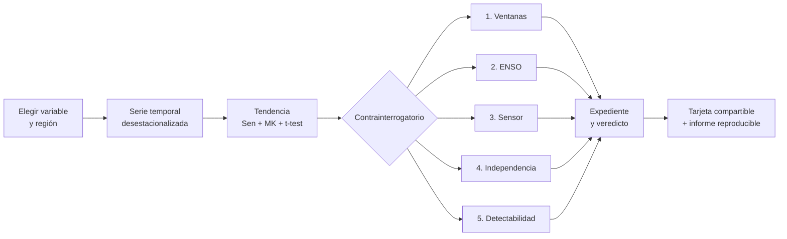
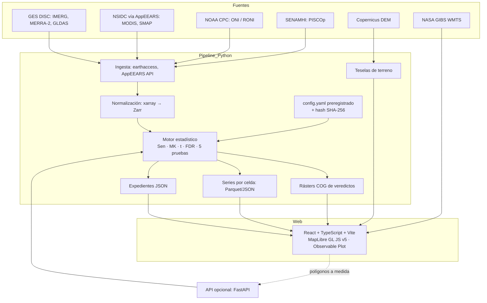

<div align="center">

# 🛰️ TerraVerdict

### *¿Es una tendencia, o solo ruido?*
**El detective que no solo encuentra tendencias en la Tierra: las somete a contrainterrogatorio antes de creerles.**

[](https://www.spaceappschallenge.org/2026/challenges/earth-system-trend-detective/)
[](https://www.spaceappschallenge.org/2026/challenges/earth-system-trend-detective/)
[](#)
[](#6-datos-fuentes-verificadas)
[](#16-hoja-de-ruta)

</div>

---

## Índice

1. [Resumen en 30 segundos](#1-resumen-en-30-segundos)
2. [El reto al que postulamos](#2-el-reto-al-que-postulamos)
3. [El problema real](#3-el-problema-real)
4. [La solución: qué es TerraVerdict](#4-la-solución-qué-es-terraverdict)
5. [El componente innovador: el Contrainterrogatorio](#5-el-componente-innovador-el-contrainterrogatorio)
6. [Datos (fuentes verificadas)](#6-datos-fuentes-verificadas)
7. [Experiencia de usuario: 3D, mapas y casos guiados](#7-experiencia-de-usuario-3d-mapas-y-casos-guiados)
8. [Metodología científica](#8-metodología-científica)
9. [Arquitectura técnica](#9-arquitectura-técnica)
10. [Validación científica y métricas](#10-validación-científica-y-métricas)
11. [Aplicación en Arequipa y Perú](#11-aplicación-en-arequipa-y-perú)
12. [Escalabilidad internacional](#12-escalabilidad-internacional)
13. [Diferenciación frente a lo que ya existe](#13-diferenciación-frente-a-lo-que-ya-existe)
14. [Viabilidad, costos y limitaciones](#14-viabilidad-costos-y-limitaciones)
15. [Alineación con los criterios y premios de Space Apps](#15-alineación-con-los-criterios-y-premios-de-space-apps)
16. [Hoja de ruta](#16-hoja-de-ruta)
17. [Estructura del repositorio y cómo ejecutar](#17-estructura-del-repositorio-y-cómo-ejecutar)
18. [Equipo](#18-equipo)
19. [Recursos y datos abiertos de la guía](#19-recursos-y-datos-abiertos-de-la-guía)
20. [Referencias](#20-referencias)
21. [Licencias y atribuciones](#21-licencias-y-atribuciones)

---

## 1. Resumen en 30 segundos

Cualquier herramienta puede trazar una línea sobre una serie de datos satelitales y decir "p < 0.05". El problema es que **muchas de esas tendencias no sobreviven a una pregunta incómoda**:

- ¿Y si empiezo el análisis un año antes o un año después?
- ¿No será que en ese periodo hubo más años de El Niño que de La Niña?
- ¿No será que cambió el satélite que tomaba la medida?
- ¿Lo confirma otro producto que **no** use los mismos datos de entrada?
- ¿Hay suficientes años de datos para poder decidirlo?

**TerraVerdict** es una herramienta web con globo 3D y terreno real que permite elegir una variable de la Tierra (lluvia, temperatura, evapotranspiración, escorrentía, humedad del suelo, nieve), seleccionar una región, ver su serie temporal y calcular su tendencia y significancia, **como pide el reto**. Además, a cada tendencia le aplica cinco pruebas automáticas de robustez, el **Contrainterrogatorio**, y entrega un **Expediente** con un veredicto y, cuando los datos no alcanzan, **cuántos años faltarían para poder decidir**.

> **Nuestra promesa:** no te decimos solo *si la Tierra está cambiando*; te decimos *cuánto puedes confiar en esa afirmación, y por qué*.

---

## 2. El reto al que postulamos

| | |
|---|---|
| **Evento** | 2026 NASA Space Apps Challenge, 14–15 de noviembre de 2026 |
| **Sede** | Arequipa, Perú |
| **Reto** | [**Be An Earth System Trend Detective!**](https://www.spaceappschallenge.org/2026/challenges/earth-system-trend-detective/) (R01 en la guía local) |
| **Dificultad** | Advanced |
| **Temas** | Earth Science, Software |

### Lo que pide el reto (resumen del enunciado oficial)

Crear una herramienta que **seleccione variables** medidas por misiones de ciencias de la Tierra o producidas por modelos, **visualice cómo cambian en el tiempo** y determine **qué cambia, dónde, cuánto y si el cambio es "significativo"**. El enunciado destaca además que una misma variable puede tender en un sentido en una región y en el sentido opuesto en otra, **aunque ambas tendencias las cause el mismo proceso**.

### Cómo cubrimos cada objetivo oficial

| Objetivo del reto | Cómo lo resuelve TerraVerdict |
|---|---|
| 1. Identificar variables de interés | Catálogo curado de 6 variables con definición en lenguaje simple, más un asistente de preguntas guiadas ("¿qué quieres investigar y dónde?") |
| 2. Obtener los datos para una región | Selección por clic, por polígono dibujado o por cuenca predefinida; series ya preprocesadas por celda y agregadas por área |
| 3. Generar y visualizar la serie temporal | Serie mensual, anomalías desestacionalizadas, recta de Sen y banda de confianza; animación de anomalías sobre el globo 3D |
| 4. Tasa de cambio y prueba de significancia | Pendiente de Sen por década con IC, Mann-Kendall con corrección por autocorrelación y regresión con tamaño muestral efectivo (t-test) |

### Consideraciones opcionales del enunciado que también cubrimos

| Sugerencia del enunciado | Respuesta |
|---|---|
| Público: estudiantes de secundaria y universidad, y público con base científica | Glosario integrado, lenguaje simple, modo "Detective" guiado y bilingüe ES/EN |
| Definiciones simples de las variables | Ficha por variable: qué mide, de dónde viene, qué limitaciones tiene |
| Preguntas guiadas y ejemplos de demostración | Asistente de 3 preguntas y **Casos del Detective** guiados paso a paso |
| "Una tendencia no significativa también es interesante; a veces solo le falta más tiempo" | Lo convertimos en una salida explícita: **"Años para decidir"** |
| Tendencias que se ven solo al quitar el ciclo estacional | Todas las pruebas se hacen sobre anomalías desestacionalizadas |
| Tendencias lineales como punto de partida | El núcleo es lineal y monotónico; lo no lineal queda fuera del alcance, como sugiere el reto |

---

## 3. El problema real

### 3.1 El problema global: tendencias que no resisten preguntas

1. **La ventana temporal manda.** Las tendencias de pocas décadas suelen no ser significativas, y mover una ventana de 30 años un solo año puede casi duplicar la pendiente ([climate.gov](https://climate.gov/comment/2959)). Elegir a conveniencia el año de inicio es una forma conocida de fabricar "tendencias".
2. **La variabilidad natural se disfraza de tendencia.** En los Andes externos, El Niño-Oscilación del Sur (ENSO) es el principal motor de la variabilidad interanual de la lluvia ([Jonaitis et al., 2021](https://geo.appstate.edu/sites/default/files/jonaitis_etal_2021_ijoc.pdf)). Un periodo con más años de El Niño al final que al inicio puede producir una "tendencia" que es solo la secuencia de fases.
3. **El instrumento también cambia.** La propia ficha de GPM IMERG advierte que los cambios en la constelación de satélites pueden introducir artefactos en estudios de cambios multianuales ([NCAR/GDEX](https://gdex.ucar.edu/datasets/d731000/)).
4. **Probar miles de píxeles a la vez genera falsos positivos.** Al hacer una prueba por celda en productos grillados, una fracción de celdas sale "significativa" por azar, y la autocorrelación espacial las agrupa en patrones espurios ([Cortés et al., GRL 2021](https://sites.bu.edu/cliveg/files/2021/03/Cortes-GRL-2021.pdf)). Aun así, las correcciones por pruebas múltiples son raras en teledetección ambiental ([Remote Sensing, 2024](https://mdpi.com/2072-4292/16/20/3886)).
5. **Ignorar la autocorrelación produce sobredetección** de tendencias significativas ([JGR Oceans](https://zendy.io/title/10.1002/jgrc.20264)).

### 3.2 El problema local: Arequipa decide con pocos datos

- La falta de datos hidrométricos y meteorológicos es el mayor problema para estudiar y evaluar los recursos hídricos en las cuencas Camaná, Majes, Sihuas y Quilca-Vítor-Chili ([estudio hidrológico con información satelital](https://core.ac.uk/download/482041099.pdf)).
- Solo tres estaciones de caudal en Arequipa tienen registros de más de 20 años y siguen activas; hay muchos datos faltantes y la regulación altera los flujos ([Purdue / Arequipa Nexus](https://ag.purdue.edu/hydrology/swm/es/documents/datos_descarga_rios.pdf)).
- En los Andes peruanos, las redes de pluviómetros son escasas y discontinuas, por lo que se depende de productos satelitales con incertidumbre persistente ([EGUsphere, 2026](https://egusphere.copernicus.org/preprints/2026/egusphere-2026-604/egusphere-2026-604.pdf)). En la costa seca, IMERG no mejora la detección ni la intensidad de lluvia y persisten errores sistemáticos ([Manz et al., 2017](https://redi.cedia.edu.ec/document/86400)).
- Las afirmaciones sobre la sequía se disputan públicamente: en una temporada, el Ministerio de Agricultura negó la escasez que SENAMHI advertía para Arequipa ([Proactivo](https://proactivo.com.pe/?p=33591)).

### 3.3 Usuarios

| Usuario | Necesidad | Qué obtiene |
|---|---|---|
| **Estudiantes de secundaria y universidad** *(público principal del reto)* | Aprender a investigar con datos reales sin caer en conclusiones falsas | Casos guiados, glosario, Expediente explicado |
| **Docentes** | Material de clase sobre ciencia de datos y clima | Casos reproducibles y exportables |
| **Periodistas y comunicadores** | Verificar una afirmación antes de publicarla | Verificador de afirmaciones con veredicto y tarjeta compartible |
| **Gestores del agua y gobiernos locales** *(Impacto Local)* | Saber qué tendencias de su cuenca son sólidas y dónde faltan datos | Mapa de veredictos y Mapa de brechas de monitoreo |
| **Investigadores** | Reproducir y auditar el análisis | Informe reproducible con versiones de datos, parámetros y hash |

---

## 4. La solución: qué es TerraVerdict

TerraVerdict es una aplicación web con **cuatro modos**:

| Modo | Qué hace |
|---|---|
| 🌍 **Explorar** | Globo 3D con terreno real. Eliges variable y periodo y ves el **Mapa de Veredictos**: magnitud de la tendencia y su robustez en un solo color |
| 🔎 **Interrogar** | Clic en una celda, cuenca o polígono: serie temporal, tendencia, significancia y las cinco pruebas del Contrainterrogatorio, con el **Expediente** final |
| 🕵️ **Casos del Detective** | Recorridos guiados paso a paso que enseñan a pensar como un científico de datos |
| ⚖️ **Verificar una afirmación** | Formulario estructurado ("la lluvia en X disminuyó entre A y B") que devuelve *Respaldada*, *Contradicha* o *No decidible*, con la causa |



---

## 5. El componente innovador: el Contrainterrogatorio

Las herramientas existentes responden **"¿hay tendencia?"**. TerraVerdict responde **"¿resiste esta tendencia a las cinco formas más comunes de engañarse?"**, y lo hace de forma automática, por celda y para cualquier usuario.

### Las cinco pruebas

| # | Prueba | Pregunta | Qué se calcula | Resultado visible |
|---|---|---|---|---|
| 1 | **Laboratorio de ventanas** | ¿La tendencia depende del año de inicio o fin que elegí? | Tendencia y significancia para **todas** las combinaciones de inicio y fin con longitud mínima preregistrada | Gráfico triangular interactivo y % de ventanas que confirman el signo |
| 2 | **Filtro ENSO** | ¿Es solo la secuencia de El Niño y La Niña? | Regresión con el índice ONI/RONI de NOAA como covariable, con rezagos preregistrados | Tendencia "cruda" frente a "sin ENSO", y % de varianza explicada por ENSO |
| 3 | **Detector de artefactos de sensor** | ¿La tendencia es un escalón del instrumento? | Modelo con y sin un salto en transiciones documentadas (p. ej. TRMM→GPM en junio de 2014 para IMERG) | Alerta "posible artefacto" y tendencia corregida |
| 4 | **Concordancia ponderada por independencia** | ¿Lo confirman fuentes que no comparten datos de entrada? | Misma prueba en varios productos; las confirmaciones se cuentan por **familias independientes**, no por número de productos | "Confirmada por N familias independientes" |
| 5 | **Detectabilidad y años para decidir** | ¿Hay suficientes datos para decidir? | Tendencia mínima detectable y años necesarios, por fórmula de Weatherhead et al. (1998) y por bootstrap por bloques | "Faltan ~X años para poder decidirlo" |

### Lo que lo hace realmente diferente

**a) La concordancia ponderada por independencia (genealogía de datos).**
Si tres productos confirman una tendencia pero los tres usan los mismos pluviómetros como insumo, no son tres confirmaciones: es una. TerraVerdict mantiene un **grafo de procedencia** documentado a partir de las fichas oficiales de cada producto. Ejemplos verificados:

| Producto | Insumos documentados |
|---|---|
| IMERG Final Run | Satélites + ajuste mensual con el análisis de pluviómetros **GPCC** ([NASA GPM](https://gpm.nasa.gov/taxonomy/term/1417)) |
| GLDAS-2.1 Noah | Forzado con **GDAS**, **GPCP** desagregado y radiación **AGRMET** ([Earth Engine / GES DISC](https://developers.google.com/earth-engine/datasets/catalog/NASA_GLDAS_V021_NOAH_G025_T3H?authuser=2)) |
| PISCOp V2.1 | Pluviómetros nacionales de SENAMHI + **CHIRP** + climatologías radar-pluviómetro ([SENAMHI](https://repositorio.senamhi.gob.pe/handle/20.500.12542/288)) |
| MERRA-2 | Reanálisis atmosférico; su precipitación se documentará desde las fichas oficiales antes de usarla en esta prueba |

El usuario ve qué productos son "parientes" y cuántas confirmaciones son realmente independientes.

**b) El Mapa de Veredictos con paletas que suprimen valores inciertos (VSUP).**
En lugar de un mapa de tendencias más un mapa de significancia por separado, usamos *Value-Suppressing Uncertainty Palettes* (Correll, Moritz y Heer, CHI 2018): cuando la incertidumbre es alta, el color pierde intensidad y diferencia. Su evaluación mostró que, frente a los mapas bivariados tradicionales, las VSUP llevan a las personas a dar más peso a la incertidumbre al decidir ([Tableau Research](https://www.tableau.com/research/publications/value-suppressing-uncertainty-palettes)). Así el mapa **no puede leerse mal**: una tendencia frágil nunca se ve tan llamativa como una robusta.

**c) "Años para decidir" convierte el "no significativo" en información útil.**
El reto dice que a veces a una tendencia solo le falta más tiempo. TerraVerdict lo cuantifica.

**d) Los "gemelos opuestos".**
El reto plantea que el mismo proceso puede producir tendencias opuestas en regiones distintas. En Perú existe un caso documentado: los episodios cálidos de El Niño (Niño 3.4) traen lluvia a la costa norte y la reducen en los Andes peruanos ([IGP](https://repositorio.igp.gob.pe/bitstreams/0f66de0b-2ffa-4d2e-bfbb-08772a2bc6cf/download)). El modo Gemelos muestra lado a lado dos regiones con tendencias de signo opuesto y su sensibilidad a ENSO, para que el usuario descubra si una causa común las explica. **Es una hipótesis que la herramienta pone a prueba, no un resultado anunciado.**

**e) Preregistro sellado.**
Antes de leer los datos, los parámetros del análisis (longitud mínima de ventana, rezagos ENSO, umbrales, α) se guardan en un archivo de configuración cuyo hash SHA-256 aparece en cada Expediente. Nadie, ni nosotros, puede ajustar las reglas después de ver el resultado sin que se note.

### Por qué no usamos IA generativa en el núcleo

Herramientas como Climinator verifican afirmaciones climáticas con modelos de lenguaje, contrastándolas con **textos** de consenso científico ([arXiv 2401.12566](https://arxiv.org/html/2401.12566v1)). TerraVerdict las contrasta con **datos**. Un modelo de lenguaje no añadiría rigor y sí riesgo de alucinación, por eso el núcleo es estadística transparente y reproducible.

---

## 6. Datos (fuentes verificadas)

> Todas las especificaciones se verificaron en fuentes oficiales o espejos oficiales. Las que no pudimos verificar están marcadas como **"por confirmar"** y no se usan en conclusiones hasta confirmarlas.

### 6.1 Catálogo de variables

| Variable | Definición simple | Producto principal | Productos de contraste |
|---|---|---|---|
| 🌧️ Precipitación | Cuánta agua cae del cielo | GPM IMERG V07 Final (mensual) | MERRA-2, GLDAS-2.1, PISCOp (solo Perú, hasta 2018) |
| 🌡️ Temperatura del aire (2 m) | Qué tan caliente está el aire cerca del suelo | MERRA-2 | GLDAS-2.1 (forzante) |
| 💨 Evapotranspiración | Agua que vuelve a la atmósfera desde el suelo y las plantas | GLDAS-2.1 Noah | — |
| 🏞️ Escorrentía | Agua que corre por la superficie y alimenta ríos | GLDAS-2.1 Noah | — |
| 🌱 Humedad del suelo | Cuánta agua guarda la capa superior del suelo | GLDAS-2.1 Noah | SMAP (solo desde 2015) |
| ❄️ Cobertura de nieve | Qué fracción del terreno está cubierta de nieve | MODIS MOD10A1F (Terra, sin nubes) | MODIS Aqua (MYD10A1F) |

### 6.2 Especificaciones y restricciones

| Fuente | Rol | Resolución / periodo | Restricciones conocidas |
|---|---|---|---|
| **GPM IMERG V07 Final Run** (NASA/JAXA) | Precipitación principal | 0.1°, global. La ficha de GPM indica cobertura desde 1998 en V07; espejos como NCAR la listan desde junio de 2000. **Fecha de inicio por confirmar en GES DISC** | Latencia de ~3.5 meses; menor habilidad en terreno complejo, superficies heladas y costas; usa TRMM hasta mayo de 2014 y GPM desde junio de 2014 |
| **MERRA-2** (NASA GMAO) | Temperatura y segunda familia de precipitación | Grilla nativa de ½° × ⅝° | Es un reanálisis (modelo + observaciones); la elevación es un promedio de la celda. Vía NASA POWER: meteorología desde 1981 y se recomienda terminar el análisis 2 meses antes del tiempo real |
| **GLDAS-2.1 Noah, mensual 0.25°** (NASA GES DISC) | Evapotranspiración, escorrentía, humedad del suelo | 0.25°, de 60°S a 90°N, desde enero de 2000; 36 campos de superficie terrestre. DOI [10.5067/SXAVCZFAQLNO](https://doi.org/10.5067/SXAVCZFAQLNO) | Salida de modelo sin asimilación ("open-loop"); depende de sus forzantes (GPCP, GDAS, AGRMET) |
| **MODIS MOD10A1F / MYD10A1F v6.1** (NSIDC) | Cobertura de nieve | 500 m, diaria; Terra desde 24/02/2000, Aqua desde 04/07/2002 | La nube es su mayor limitación; el relleno sin nubes usa el último día despejado; nieve fina o efímera puede no detectarse |
| **SMAP L3** (NSIDC) | Humedad del suelo (contraste reciente) | 36 km (L3 estándar), diaria, desde 31/03/2015 | Unos 11 años: insuficiente para tendencias climáticas; solo contraste |
| **ONI / RONI** (NOAA CPC) | Covariable ENSO | Mensual desde 1950 | No es dato de NASA; desde 2026 NOAA usa el RONI para el monitoreo oficial, por eso probamos ambos |
| **PISCOp V2.1** (SENAMHI) | Referencia con pluviómetros para Perú | 0.1°, diaria y mensual, 1981–2018 | SENAMHI suspendió su actualización en tiempo casi real; licencia CC BY-NC-ND; incluye CHIRP, por lo que no es totalmente independiente de satélite |
| **Copernicus DEM GLO-30 / GLO-90** (ESA) | Terreno 3D y perfiles de elevación | 30 m y 90 m, global, gratuito; en AWS Open Data como COG | Es un modelo de superficie (incluye edificios y vegetación); requiere nota de atribución si se modifica |
| **NASA GIBS** | Mapa base de imágenes satelitales | WMTS/WMS gratuitos | Solo visual: no se usa para cálculos |

### 6.3 Fuentes evaluadas y descartadas (con motivo)

| Fuente | Por qué no entra al núcleo |
|---|---|
| **NISAR** | La publicación calibrada comenzó el 20/07/2026 con observaciones desde el 17/06/2026: no hay historia para tendencias. Además existe otro reto específico para NISAR |
| **GRACE / GRACE-FO** | Resolución efectiva de ~300 km: demasiado gruesa para una cuenca como la del Chili. Puede usarse a escala continental en una fase futura |
| **FIRMS (incendios)** | Fuera del foco hidroclimático del MVP; candidato para la fase de escalamiento |
| **Giovanni** | No es una fuente sino una herramienta: la usamos para **validar** que nuestras series coinciden con las de NASA |

---

## 7. Experiencia de usuario: 3D, mapas y casos guiados

### 7.1 Globo 3D con terreno real

- **Motor:** MapLibre GL JS v5, que soporta proyección de globo y terreno 3D sobre el globo desde su versión 5.0 ([release notes](https://newreleases.io/project/github/maplibre/maplibre-gl-js/release/v5.0.0)). Es código abierto y no requiere claves de pago.
- **Terreno:** teselas de elevación generadas por nosotros desde Copernicus DEM, con exageración vertical ajustable. Los Andes importan: la lluvia y la temperatura cambian con la altura, y verlo en 3D lo hace evidente.
- **Mapa base:** imágenes de color verdadero MODIS desde NASA GIBS.
- **Capa de datos:** el Mapa de Veredictos se proyecta sobre el terreno.

### 7.2 Vistas interactivas

| Vista | Qué muestra | Por qué importa |
|---|---|---|
| 🗺️ **Mapa de Veredictos (VSUP)** | Magnitud de la tendencia y robustez en un solo color | Lo frágil se ve apagado; lo robusto, intenso |
| 🏔️ **Corte transversal 3D** | Perfil de elevación del Pacífico a la Amazonía (p. ej. a la latitud de Arequipa) con la tendencia y la robustez de cada celda a lo largo del perfil | Muestra si las tendencias cambian con la altitud |
| 🔺 **Laboratorio de ventanas** | Triángulo de inicio×fin coloreado por tendencia; clic en una celda del triángulo y la serie se recalcula | Hace visible el *cherry-picking* |
| 🌊 **Interruptor ENSO** | Serie con y sin el efecto de ENSO, y fases El Niño/La Niña sombreadas | Muestra cuánto era variabilidad natural |
| 👯 **Modo Gemelos** | Dos mapas sincronizados con regiones de signo opuesto y sus correlaciones con ENSO | Responde directamente al rompecabezas del reto |
| ⏯️ **Línea de tiempo** | Animación mensual de anomalías sobre el globo | Engancha al público y muestra el ciclo estacional |
| 📍 **Mapa de brechas** | Dónde la tendencia es "no decidible" y no hay estaciones cerca | Prioriza dónde medir más |

### 7.3 El Expediente

```
┌───────────────────────────────────────────────────────────┐
│ EXPEDIENTE TV-2026-0001            Precipitación · IMERG │
│ Región: Cuenca alta del río Chili, Arequipa              │
│ Periodo: ventana completa disponible · anomalías         │
├───────────────────────────────────────────────────────────┤
│ Tendencia (Sen)........  ±X.X mm/mes por década [IC 95%] │
│ Mann-Kendall (Hamed-Rao) p = 0.0XX   ·   FDR: q = 0.0XX  │
├───────────────────────────────────────────────────────────┤
│ CONTRAINTERROGATORIO                                      │
│ [✓/✗] 1. Ventanas ......... XX % confirman el signo      │
│ [✓/✗] 2. ENSO ............. tendencia sin ENSO: ±X.X      │
│ [✓/✗] 3. Sensor ........... salto 2014-06: sí/no         │
│ [✓/✗] 4. Independencia .... N familias independientes    │
│ [✓/✗] 5. Detectabilidad ... faltan ~XX años              │
├───────────────────────────────────────────────────────────┤
│ VEREDICTO: ROBUSTA / FRÁGIL / NO DECIDIBLE / SIN TENDENCIA│
│ Config preregistrada: sha256:xxxxxxxx… · Datos: DOIs      │
└───────────────────────────────────────────────────────────┘
```
*(Valores ilustrativos de formato: ningún número de este README es un resultado calculado.)*

Se exporta como **tarjeta PNG con QR**, **PDF**, **JSON reproducible** y un **notebook Jupyter** que reproduce el cálculo.

### 7.4 Casos del Detective (demostraciones guiadas)

Los casos están planteados como **preguntas a investigar**; su resultado depende de los datos y no se anuncia por adelantado.

| Caso | Pregunta | Qué enseña |
|---|---|---|
| 🕵️ **Caso 1: "¿Llueve menos en Arequipa?"** | ¿Hay una tendencia robusta de lluvia en la cuenca del Chili? | Comparar productos, ver la genealogía de datos y los años para decidir |
| 🕵️ **Caso 2: "Mismo océano, historias opuestas"** | ¿La costa norte y el altiplano sur tienen tendencias opuestas con una causa común? | El rompecabezas del reto, explicado con ENSO |
| 🕵️ **Caso 3: "El salto del satélite"** | ¿Hay celdas donde la tendencia cambia al considerar la transición TRMM→GPM? | Que los instrumentos también cambian |
| 🕵️ **Caso 4: "Control positivo"** | ¿TerraVerdict reproduce una tendencia ya publicada en la literatura? | Que la herramienta funciona |

### 7.5 Accesibilidad

Bilingüe ES/EN · paletas aptas para daltonismo · funciona en móvil · modo de bajo ancho de banda (vista 2D sin terreno) · glosario contextual en cada término técnico.

---

## 8. Metodología científica

### 8.1 Preprocesamiento

1. Descarga de los productos mensuales y recorte a la región.
2. Control de calidad: banderas oficiales de cada producto y conteo de muestras válidas.
3. **Anomalías desestacionalizadas:** se resta la climatología mensual del periodo base.
4. Agregación por área ponderada por el área de cada celda (coseno de la latitud).

### 8.2 Tendencia y significancia (núcleo del reto)

| Elemento | Método | Referencia |
|---|---|---|
| Pendiente | Estimador de Theil-Sen, expresado por década, con IC 95 % | Sen (1968) |
| Significancia no paramétrica | Mann-Kendall modificado por autocorrelación (Hamed-Rao) y prueba con preblanqueo (Yue-Wang) como sensibilidad | Hamed y Rao (1998); Yue y Wang (2004) |
| Significancia paramétrica | t-test de la pendiente MCO con tamaño muestral efectivo n_eff = n(1−r₁)/(1+r₁) | Santer et al. (2000) |
| Pruebas múltiples en el mapa | Control de la tasa de falsos descubrimientos de Benjamini-Hochberg, con α_FDR = 2α para campos con correlación espacial | Benjamini y Hochberg (1995); Wilks (2016) |

### 8.3 Las cinco pruebas en detalle

**Prueba 1. Laboratorio de ventanas.**
Para cada par (inicio, fin) con longitud ≥ L_min (preregistrada, p. ej. 15 años), se calcula la pendiente y su significancia. Se reporta la fracción de ventanas con el mismo signo que la ventana completa y la fracción significativa. Pasa si la fracción del mismo signo supera el umbral preregistrado.

**Prueba 2. Filtro ENSO.**
Modelo: `anomalía(t) = a + b·t + Σₖ cₖ·ONI(t−k) + ε(t)`, con rezagos k = 0…3 meses y selección del rezago por una regla fija preregistrada. Se compara `b` con y sin el término ENSO y se reporta la varianza explicada por ENSO. Se repite con RONI como sensibilidad. Pasa si la tendencia mantiene signo y significancia tras incluir ENSO.

**Prueba 3. Artefactos de sensor.**
Para productos con transiciones documentadas, como IMERG en junio de 2014, se ajusta el modelo con un escalón en la fecha de transición y se compara con el modelo sin escalón (criterio de información y cambio en `b`). Como sensibilidad, se aplica la prueba de punto de cambio de Pettitt para ver si el quiebre más probable coincide con la transición. Pasa si la tendencia no depende del escalón.

**Prueba 4. Concordancia ponderada por independencia.**
Se ejecuta el mismo análisis en todos los productos disponibles para la variable. Los productos se agrupan en familias según el grafo de procedencia (insumos compartidos). Pasa si al menos dos **familias** independientes coinciden en el signo.

**Prueba 5. Detectabilidad y años para decidir.**
- **Analítica:** número de años necesarios para detectar una tendencia ω₀ con ruido AR(1) de desviación σ_N y autocorrelación φ (Weatherhead et al., 1998):

  n* ≈ [ (3.3 · σ_N / |ω₀|) · √((1+φ)/(1−φ)) ]^(2/3)

- **Empírica:** bootstrap por bloques móviles de los residuos (preserva la autocorrelación), inyección de tendencias sintéticas y cálculo de potencia al 80 %.
- Salidas: **tendencia mínima detectable** con los datos actuales y **años adicionales necesarios** para decidir sobre la tendencia observada o la afirmada.

### 8.4 Reglas de veredicto (preregistradas)

| Veredicto | Condición |
|---|---|
| 🟢 **Robusta** | Significativa tras FDR **y** supera las pruebas 1 a 4 |
| 🟡 **Frágil** | Significativa, pero falla al menos una prueba (se indica cuál) |
| ⚪ **No decidible** | No significativa **y** la potencia es insuficiente: se muestran los años para decidir |
| 🔵 **Sin tendencia detectable** | No significativa **con** potencia suficiente para detectar la tendencia mínima de interés |

En el modo Verificar, una afirmación es **Respaldada** si el veredicto es robusto y del mismo signo, **Contradicha** si es robusto y de signo opuesto, y **No decidible** en los demás casos, siempre con la causa.

---

## 9. Arquitectura técnica



| Capa | Tecnología | Motivo |
|---|---|---|
| Ingesta | `earthaccess` (NASA), API de AppEEARS, API de NASA POWER | Acceso oficial con cuenta Earthdata gratuita |
| Procesamiento | Python, `xarray`, `rioxarray`, `numpy`, `scipy`, `statsmodels`, `pymannkendall` | Estándar científico abierto |
| Almacenamiento | Zarr (intermedio), Cloud-Optimized GeoTIFF y Parquet/JSON (salidas) | Servido como estático, sin base de datos |
| Frontend | React + TypeScript + Vite, MapLibre GL JS v5 (globo + terreno), Observable Plot o D3 | Abierto y sin claves de pago |
| API opcional | FastAPI, solo para polígonos personalizados | El MVP funciona 100 % estático |
| Reproducibilidad | Config preregistrada con hash, versiones y DOIs de datos en cada Expediente, notebooks | Auditabilidad |
| Calidad | `pytest` con casos de referencia y CI en GitHub Actions | Pruebas contra implementaciones de referencia |

**Decisión clave: "precalcular primero".** Las regiones piloto se procesan por adelantado y se publican como archivos estáticos. Esto hace la app rápida, barata y fácil de alojar.

---

## 10. Validación científica y métricas

| # | Validación | Cómo | Criterio de éxito |
|---|---|---|---|
| V1 | **Exactitud del motor** | Pruebas unitarias contra `pymannkendall`, `scipy` y series sintéticas con tendencia conocida | Coincidencia numérica dentro de la tolerancia |
| V2 | **Calibración estadística** | Simulación Monte Carlo: series AR(1) sin tendencia más forzamiento tipo ENSO desbalanceado | La tasa de falsos positivos del veredicto "Robusta" se mantiene cerca de α, mientras la tendencia cruda la supera |
| V3 | **Potencia** | Tendencias sembradas de magnitud conocida | Curvas de potencia coherentes con la fórmula de Weatherhead |
| V4 | **Reproducción NASA** | Comparar series de área con las de Giovanni para el mismo producto, región y periodo | Diferencias dentro de la tolerancia preregistrada |
| V5 | **Coherencia física** | Signo del mapa de correlación ENSO-lluvia contra la literatura para Perú | Coincidencia con lo publicado |
| V6 | **Control positivo** | Reproducir una tendencia publicada (Caso 4) | Mismo signo y magnitud comparable |
| V7 | **Verdad terrestre** *(si se obtienen datos)* | Estaciones SENAMHI en la cuenca del Chili | Celdas "Robustas" concuerdan con la estación más que las "Frágiles" |
| V8 | **Usabilidad** | Prueba con estudiantes (UNSA): System Usability Scale y cuestionario antes y después sobre interpretación de tendencias | Mejora medible en la detección de tendencias engañosas |

**Métricas de impacto que reportará la herramienta:** % del área decidible hoy por variable · años medios para decidir · % de tendencias "significativas" que resultan frágiles · % de celdas donde ENSO cambia el veredicto · % de celdas con posible artefacto de sensor.

---

## 11. Aplicación en Arequipa y Perú

**Piloto:** cuenca Quilca-Vítor-Chili (Arequipa) y franja sur del Perú de la costa al altiplano.

| Actor | Uso concreto |
|---|---|
| Gobierno Regional, ANA, AUTODEMA, SEDAPAR | Saber qué tendencias de lluvia, nieve y humedad de la cuenca son robustas antes de usarlas en planificación |
| SENAMHI Arequipa | Mapa de brechas: dónde una nueva estación reduciría más la incertidumbre |
| UNSA y colegios | Material didáctico con datos de su propia región |
| Periodistas locales | Verificar afirmaciones sobre sequía o lluvias antes de publicarlas |

Los productos se eligieron porque cubren Perú completo, así que el mismo flujo se aplica a cualquier cuenca peruana cambiando solo la región en la configuración.

---

## 12. Escalabilidad internacional

- **Datos globales:** IMERG, MERRA-2 y MODIS son globales; GLDAS cubre de 60°S a 90°N. El único componente específico de Perú es PISCOp, que es opcional y se reemplaza por el producto nacional equivalente de cada país.
- **Replicación por configuración:** una nueva región es un archivo YAML (límites, variables, periodo).
- **Prioridad:** regiones montañosas con pocos datos y alta influencia de ENSO, donde el problema de las tendencias engañosas es mayor.
- **Conexión global:** biblioteca abierta de Casos del Detective donde docentes de cualquier país proponen casos mediante *pull requests* revisados, y Expedientes compartibles con enlace.
- **Idiomas:** ES/EN en el MVP; la interfaz está preparada para más idiomas.

---

## 13. Diferenciación frente a lo que ya existe

| Solución | Qué hace | Qué le falta y TerraVerdict añade |
|---|---|---|
| **Giovanni (NASA)** | Series temporales y mapas de productos NASA sin programar | No evalúa robustez de tendencias ni explica la incertidumbre al público |
| **Worldview (NASA)** | Explorar imágenes satelitales en el tiempo | Es visual, no estadístico |
| **Otras entradas del mismo reto en GitHub** (globos 3D con Mann-Kendall y Sen; una con FDR y autocorrelación) | Detectan y mapean tendencias significativas | No encontramos en ellas pruebas de ventanas, filtro ENSO, artefactos de sensor, concordancia por independencia ni "años para decidir" |
| **Climinator** (verificación de afirmaciones climáticas con LLM) | Contrasta afirmaciones contra textos científicos | No contrasta contra datos satelitales |
| **Marco "Robust Trend Analysis"** (Remote Sensing, 2024) | Encadena Theil-Sen, Mann-Kendall contextual y FDR | Es un método de investigación, no una herramienta educativa interactiva con las cinco pruebas |

> **Nota de honestidad:** cada técnica por separado es conocida en la literatura. La contribución de TerraVerdict es **integrarlas y automatizarlas por celda en una herramienta interactiva para el público**, con la concordancia ponderada por independencia y la visualización VSUP. No encontramos una herramienta que haga esto; no afirmamos que no exista.

---

## 14. Viabilidad, costos y limitaciones

### 14.1 Costos

| Rubro | Costo |
|---|---|
| Datos | US$ 0 (cuenta Earthdata gratuita; DEM y GIBS gratuitos) |
| Cómputo para regiones piloto | US$ 0 (una laptop; las regiones son de cientos a miles de celdas) |
| Alojamiento | US$ 0 en planes gratuitos de hosting estático |
| API opcional | Bajo costo, solo si se activa |

### 14.2 Limitaciones reales

- **Series cortas:** unos 25 años de IMERG y GLDAS-2.1 son pocos para separar tendencias de la variabilidad decadal; el Pacífico interdecadal también influye en la lluvia de los Andes centrales ([Sulca et al.](https://www.frontiersin.org/journals/earth-science/articles/10.3389/feart.2022.954954/pdf)). Por eso hablamos de "efecto de ENSO", no de "toda la variabilidad natural".
- **Resolución:** 0.1°–0.5° es grueso para la topografía andina.
- **Productos de modelo:** GLDAS y MERRA-2 son modelos con observaciones; sus tendencias heredan sus forzantes.
- **Correlación no es causalidad:** la herramienta dice si una tendencia es robusta, no qué la causa.
- **La relación ENSO-lluvia varía:** cambia de signo según la cercanía a la Amazonía y puede invertirse en el tiempo ([Jonaitis et al., 2021](https://geo.appstate.edu/sites/default/files/jonaitis_etal_2021_ijoc.pdf)), por eso se estima por celda.
- **Latencia:** IMERG Final llega con ~3.5 meses de retraso: la herramienta es para tendencias, no para monitoreo en tiempo real.
- **Datos de estaciones:** el acceso a series de SENAMHI no está garantizado; la validación V7 depende de ello.

---

## 15. Alineación con los criterios y premios de Space Apps

| Criterio | Cómo apuntamos al nivel 4 |
|---|---|
| **Impacto** | Problema global (tendencias engañosas) con caso local concreto (agua en Arequipa) |
| **Creatividad** | Contrainterrogatorio de 5 pruebas, concordancia por independencia y VSUP, componentes originales del equipo |
| **Validez** | Validación V1–V6 en entorno controlado y V7–V8 en entorno real |
| **Pertinencia** | Cubre los 4 objetivos oficiales y las consideraciones opcionales del enunciado |
| **Presentación** | Casos guiados con una historia clara: "una tendencia que parecía cierta… y el interrogatorio que la pone a prueba" |
| **Diversidad** | Roles complementarios: datos, desarrollo, comunicación y validación científica |

**Premios globales a los que apunta:** Mejor Uso de la Ciencia · Mejor Uso de los Datos · Impacto Local · *(secundarios)* Impacto Galáctico y Conexión Global.

---

## 16. Hoja de ruta

| Fase | Alcance |
|---|---|
| **Fase 0: Hackathon (48 h)** | Precipitación y temperatura · franja sur del Perú · núcleo del reto + pruebas 1, 2 y 5 · globo 3D con Mapa de Veredictos · Expediente · Casos 1 y 2 · video y README |
| **Fase 1: 1–3 meses** | Pruebas 3 y 4 completas · 6 variables · Modo Gemelos y Corte 3D · validación V1–V6 · bilingüe |
| **Fase 2: 3–6 meses** | Validación con estaciones (V7) · prueba de usabilidad con estudiantes (V8) · alianza con UNSA / SENAMHI · artículo científico |
| **Fase 3: 6–12 meses** | Otras regiones andinas y montañosas · biblioteca abierta de casos · API pública |

---

## 17. Estructura del repositorio y cómo ejecutar

> 🚧 **Estado actual:** documento de diseño. La estructura y los comandos describen el plan de implementación.

```
terraverdict/
├── README.md
├── config/
│   ├── preregistro.yaml         # parámetros del análisis (se hashea)
│   └── regiones/                # una región = un YAML
├── pipeline/                    # Python
│   ├── ingesta/                 # earthaccess, AppEEARS, POWER, NOAA
│   ├── preproceso/              # recorte, QC, anomalías
│   ├── motor/                   # sen, mk, ttest, fdr
│   ├── contrainterrogatorio/    # ventanas, enso, sensor, independencia, detectabilidad
│   ├── genealogia/              # grafo de procedencia de productos
│   └── exportar/                # COG, Parquet/JSON, expedientes
├── web/                         # React + TS + MapLibre
│   └── src/{globo,vistas,expediente,casos,glosario,i18n}
├── notebooks/                   # reproducción y casos
├── tests/                       # V1–V3
└── docs/                        # metodología, fichas de datos, casos
```

```bash
# 1. Credenciales (cuenta gratuita en https://urs.earthdata.nasa.gov)
export EARTHDATA_USERNAME=... EARTHDATA_PASSWORD=...

# 2. Pipeline
pip install -r pipeline/requirements.txt
python -m pipeline.run --region config/regiones/sur_peru.yaml

# 3. Web
cd web && npm install && npm run dev
```

---

## 18. Equipo

| Integrante | Formación | Rol |
|---|---|---|
| Ower López | Ingeniería de Sistemas (UNSA) | Arquitectura, backend y pipeline |
| *[Nombre]* | Ingeniería de Sistemas, enfoque en datos | Motor estadístico y validación |
| *[Nombre]* | Comunicación | Narrativa, casos guiados y video |
| *[Nombre]* | *[Cupo flexible]* | *[Rol]* |

---

## 19. Recursos y datos abiertos de la guía

Lista completa de la guía de datos abiertos de la sede, con su uso en el proyecto.

### Portales generales

| Recurso | Enlace | Uso en TerraVerdict |
|---|---|---|
| Catálogo de datasets | https://data.nasa.gov | Búsqueda de productos |
| APIs abiertas | https://api.nasa.gov | No usado (rovers, asteroides, APOD) |
| Portal de datos de la Tierra | https://earthdata.nasa.gov | Fuente principal |
| Cuenta Earthdata | https://urs.earthdata.nasa.gov | Necesaria para descargar |
| Buscador de datasets | https://search.earthdata.nasa.gov | Localizar productos y granules |
| Worldview | https://worldview.earthdata.nasa.gov | Contexto visual y enlace desde el Expediente |
| Imágenes NASA | https://images.nasa.gov | Material para la presentación |
| Retos oficiales | https://www.spaceappschallenge.org/2026/challenges/ | Enunciado del reto |

### Retos de la Tierra

| Recurso | Enlace | Uso |
|---|---|---|
| R01 Tendencias: Giovanni | https://giovanni.gsfc.nasa.gov | Validación V4 |
| R02 Radar NISAR | https://search.asf.alaska.edu · https://nisar.jpl.nasa.gov | Descartado para tendencias (ver 6.3) |
| R03 Clima por coordenadas: NASA POWER | https://power.larc.nasa.gov | Acceso a MERRA-2 por punto |
| R03 Humedad del suelo: SMAP | https://smap.jpl.nasa.gov | Contraste reciente (desde 2015) |
| R03/R04 Extracción por zona: AppEEARS | https://appeears.earthdatacloud.nasa.gov | Extracción de MODIS y SMAP |
| R04 Incendios: FIRMS | https://firms.modaps.eosdis.nasa.gov | Fase futura |
| R05 Sonificación | https://chandra.si.edu/sound/ | Inspiración para accesibilidad futura |

### Luna y Marte

| Recurso | Enlace | Uso |
|---|---|---|
| Moon Trek y Mars Trek | https://trek.nasa.gov | No aplica a este reto |
| Planetary Data System | https://pds.nasa.gov | No aplica |
| HiRISE | https://hirise.lpl.arizona.edu | No aplica |
| Catálogo histórico de misiones | https://nssdc.gsfc.nasa.gov | No aplica |
| Landsat y relieve (EarthExplorer) | https://earthexplorer.usgs.gov | Alternativa de relieve |

### Ciencia, tripulación y cielo

| Recurso | Enlace | Uso |
|---|---|---|
| R12 Experimentos en la Estación Espacial | https://psi.nasa.gov | No aplica |
| R13 Biología espacial (OSDR) | https://osdr.nasa.gov | No aplica |
| R13 Human Research Program | https://www.nasa.gov/hrp | No aplica |
| R14 SPHEREx (IRSA) | https://irsa.ipac.caltech.edu | No aplica |

### Agencias aliadas

| Recurso | Enlace | Uso |
|---|---|---|
| ESA / Copernicus Data Space | https://dataspace.copernicus.eu | Copernicus DEM (terreno 3D) |
| JAXA G-Portal | https://gportal.jaxa.jp | Fase futura (productos GSMaP) |
| CSA (Canadá) | https://www.asc-csa.gc.ca | No usado |

### Fuentes complementarias usadas

| Recurso | Enlace |
|---|---|
| GES DISC (IMERG, MERRA-2, GLDAS) | https://disc.gsfc.nasa.gov |
| NSIDC (MODIS nieve, SMAP) | https://nsidc.org/data |
| NOAA CPC: ONI | https://psl.noaa.gov/data/timeseries/month/ONI/ |
| NOAA CPC: índices (RONI) | https://cpc.ncep.noaa.gov/data/indices/ |
| PISCOp V2.1 (SENAMHI) | https://piscoprec.github.io/webPISCO/en/about |
| Copernicus DEM en AWS | https://registry.opendata.aws/copernicus-dem/ |
| NASA GIBS | https://www.earthdata.nasa.gov/gibs |
| MapLibre GL JS | https://maplibre.org |

---

## 20. Referencias

**Estadística y métodos**
- Benjamini, Y. y Hochberg, Y. (1995). Controlling the false discovery rate. *JRSS-B*.
- Hamed, K. H. y Rao, A. R. (1998). A modified Mann-Kendall trend test for autocorrelated data. *Journal of Hydrology*.
- Mann, H. B. (1945); Kendall, M. G. (1975). Pruebas de tendencia no paramétricas.
- Pettitt, A. N. (1979). A non-parametric approach to the change-point problem. *Applied Statistics*.
- Santer, B. D. et al. (2000). Statistical significance of trends and trend differences in layer-average atmospheric temperature time series. *JGR*.
- Sen, P. K. (1968). Estimates of the regression coefficient based on Kendall's tau. *JASA*.
- Weatherhead, E. C. et al. (1998). Factors affecting the detection of trends. *JGR*.
- Wilks, D. S. (2016). "The stippling shows statistically significant grid points". *BAMS*.
- Yue, S. y Wang, C. (2004). The Mann-Kendall test modified by effective sample size. *Water Resources Management*.
- Cortés, J. et al. (2021). Where are global vegetation greening and browning trends significant? *GRL*. [PDF](https://sites.bu.edu/cliveg/files/2021/03/Cortes-GRL-2021.pdf)
- Robust trend analysis in remote sensing (2024). *Remote Sensing* 16(20):3886. [Enlace](https://mdpi.com/2072-4292/16/20/3886)

**Visualización**
- Correll, M., Moritz, D. y Heer, J. (2018). Value-Suppressing Uncertainty Palettes. *CHI 2018*. [Enlace](https://www.tableau.com/research/publications/value-suppressing-uncertainty-palettes)

**Clima de los Andes y datos regionales**
- Jonaitis, J. A. et al. (2021). Spatiotemporal patterns of ENSO-precipitation relationships in the tropical Andes of southern Peru and Bolivia. *Int. J. Climatology*. [PDF](https://geo.appstate.edu/sites/default/files/jonaitis_etal_2021_ijoc.pdf)
- Sulca, J., Vuille, M. y Dong, B. Interdecadal variability of the austral summer precipitation over the Central Andes. *Frontiers in Earth Science*. [PDF](https://www.frontiersin.org/journals/earth-science/articles/10.3389/feart.2022.954954/pdf)
- Manz, B. et al. (2017). Comparative ground validation of IMERG and TMPA in the tropical Andes. *J. Hydrometeorology*. [Enlace](https://redi.cedia.edu.ec/document/86400)
- Aybar, C. et al. (2020). Construction of a high-resolution gridded rainfall dataset for Peru from 1981 to the present day. *Hydrological Sciences Journal*. DOI [10.1080/02626667.2019.1649411](https://doi.org/10.1080/02626667.2019.1649411)

**Fichas de datos**
- GPM IMERG Final Run: https://gpm.nasa.gov/taxonomy/term/1417
- GLDAS-2.1 Noah mensual 0.25°: https://www.earthdata.nasa.gov/fr/data/catalog/ges-disc-gldas-noah025-m-2.1
- MOD10A1F v6.1: https://nsidc.org/data/MOD10A1F/versions/61
- SMAP SPL3SMP: https://nsidc.org/data/spl3smp/
- NASA POWER, fuentes: https://power.larc.nasa.gov/docs/methodology/data/sources/
- Disponibilidad de NISAR: https://nisar-docs.asf.alaska.edu/availability-overview/

---

## 21. Licencias y atribuciones

- **Código:** MIT (propuesto).
- **Datos NASA:** abiertos; se citan los DOIs de cada producto en cada Expediente.
- **PISCOp V2.1:** CC BY-NC-ND según el repositorio de SENAMHI; se usa solo para validación y sin redistribuir derivados.
- **Copernicus DEM:** licencia gratuita de Copernicus; se incluye la nota de atribución exigida para datos adaptados.
- **NASA GIBS:** "We acknowledge the use of imagery provided by services from NASA's Global Imagery Browse Services (GIBS), part of NASA's Earth Science Data and Information System (ESDIS)."
- **ONI / RONI:** NOAA Climate Prediction Center.

<div align="center">

---

**TerraVerdict** · NASA Space Apps Challenge 2026 · Arequipa, Perú
*No basta con encontrar una tendencia. Hay que interrogarla.*

</div>
