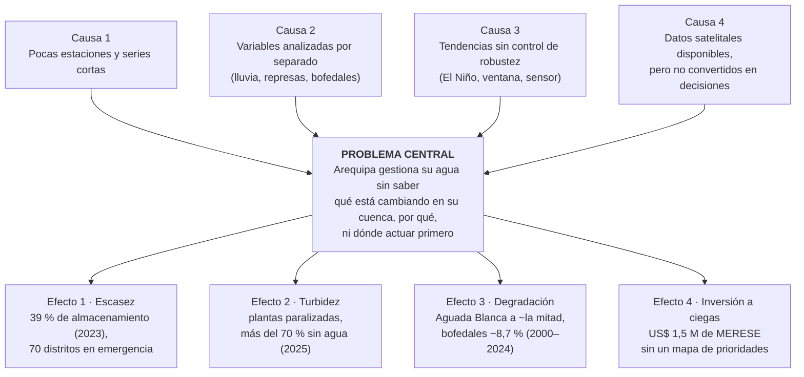
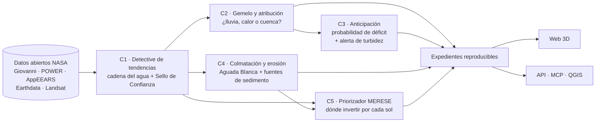
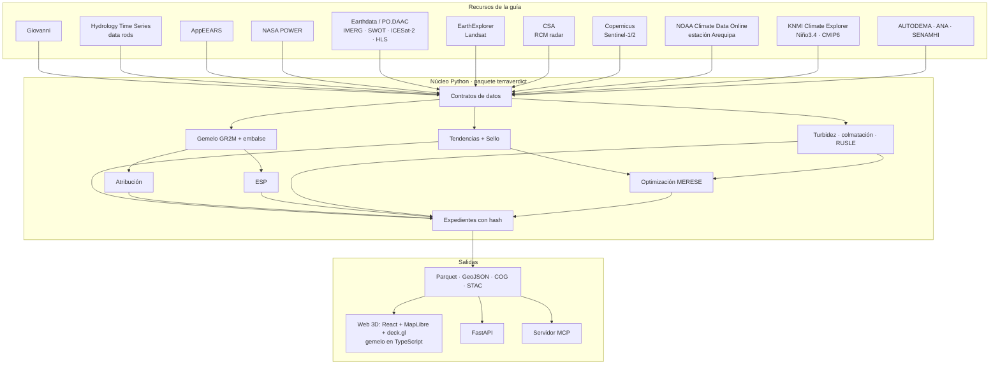

<div align="center">

# 🛰️ TerraVerdict

### *Arequipa se queda sin agua por falta… y por exceso*
**Un sistema de inteligencia hídrica con datos de NASA que detecta las tendencias de la cuenca del Chili, explica por qué cambia el agua, anticipa la escasez y la turbidez, y dice dónde invertir para proteger la fuente. Empieza en Arequipa y sirve para cualquier ciudad que vive del agua de una montaña.**

[](https://www.spaceappschallenge.org/2026/challenges/earth-system-trend-detective/)
[](https://www.spaceappschallenge.org/2026/challenges/earth-system-trend-detective/)
[](#)
[](#7-datos-recursos-oficiales-del-reto-y-de-la-guía)
[](#6-componentes-de-la-solución)
[](docs/diseno-tecnico.md)

</div>

---

## Índice

**Parte I · Planteamiento del problema**
1. [Descripción de la realidad problemática](#1-descripción-de-la-realidad-problemática)
2. [Árbol del problema](#2-árbol-del-problema)
3. [Formulación del problema](#3-formulación-del-problema)
4. [Justificación](#4-justificación)
5. [Objetivos](#5-objetivos)

**Parte II · Planteamiento de la solución**

6. [Componentes de la solución](#6-componentes-de-la-solución)
7. [Datos: recursos oficiales del reto y de la guía](#7-datos-recursos-oficiales-del-reto-y-de-la-guía)
8. [Experiencia: Arequipa en 3D](#8-experiencia-arequipa-en-3d)
9. [Arquitectura](#9-arquitectura)
10. [Validación e indicadores](#10-validación-e-indicadores)
11. [Plan para las 48 horas](#11-plan-para-las-48-horas)

**Parte III · Impacto y escala**

12. [Usuarios y decisiones que cambia](#12-usuarios-y-decisiones-que-cambia)
13. [Escala global](#13-escala-global)
14. [Cómo cubre el reto y los criterios](#14-cómo-cubre-el-reto-y-los-criterios)
15. [Limitaciones y riesgos](#15-limitaciones-y-riesgos)
16. [Repositorio, equipo y referencias](#16-repositorio-equipo-y-referencias)

📐 Ecuaciones, decisiones de arquitectura, contratos de datos y pruebas: [`docs/diseno-tecnico.md`](docs/diseno-tecnico.md) · Guía de recursos de la sede: [`docs/recursos-guia.md`](docs/recursos-guia.md)

---

## Resumen en 30 segundos

Arequipa (Perú) es una ciudad del desierto que depende de **siete represas** en la cabecera del río Chili. En los últimos tres años vivió **las dos caras de la misma crisis**:

- 🏜️ **Por falta:** en noviembre de 2023 las represas guardaban **159 de 409 hm³**, cerca del 39 % ([La República](https://larepublica.pe/sociedad/2023/11/07/arequipa-represas-del-sur-tienen-bajo-nivel-de-almacenamiento-de-agua-lrsd-444311)), y el Gobierno declaró **70 distritos en emergencia** por déficit hídrico ([Andina](https://andina.pe/agencia/noticia-deficit-hidrico-estos-son-los-70-distritos-arequipa-declarados-emergencia-961301.aspx)).
- 🌊 **Por exceso:** en febrero de 2025 las lluvias llevaron la turbidez del Chili a **5 000 NTU**, y SEDAPAR detuvo sus dos plantas de La Tomilla, dejando sin agua a **más del 70 % de la población** ([El Búho](https://elbuho.pe/2025/02/lluvias-en-arequipa-sedapar-detiene-produccion-de-agua-potable-y-pide-a-poblacion-almacenarla/), [Andina](https://andina.pe/agencia/noticia-arequipa-sin-agua-potable-corte-del-servicio-afecta-a-mas-del-70-de-poblacion-977336.aspx)).
- 🪨 **Y por desgaste:** la represa Aguada Blanca, diseñada para **43 hm³**, hoy puede contener **unos 22 hm³** por los sedimentos ([El Búho](https://elbuho.pe/2024/03/arequipa-proyectan-nueva-represa-ante-altos-niveles-de-colmatacion-en-aguada-blanca/)).

Las tres caras tienen **una raíz común**: el estado de la **cabecera de cuenca** (lluvia, calor, bofedales, suelo y sedimento) y un clima que cambia. Las tres **se ven desde el espacio**, pero hoy nadie las mira juntas.

**TerraVerdict** junta los datos abiertos de NASA en un solo sistema:

1. 🕵️ **Detecta tendencias** en cada tramo del agua, del cielo a la represa, con pruebas que evitan conclusiones falsas. Es el núcleo del reto.
2. 🔬 **Explica** qué parte del cambio se debe a menos lluvia, a más calor o a la cuenca, con un gemelo hidrológico calibrado desde el espacio.
3. 📈 **Anticipa** la probabilidad de terminar la temporada con poca agua y **alerta** cuando una lluvia intensa amenaza con enturbiar el río.
4. 🎯 **Prioriza** dónde invertir el fondo de conservación que **ya existe**: el MERESE de SEDAPAR, con **US$ 1,5 millones comprometidos para 2024–2026** ([Forest Trends](https://www.forest-trends.org/wp-content/uploads/2024/10/Brochure-Merese-COP-14.01.25.pdf)).

> **La frase para el jurado:** *"Arequipa no tiene un problema de agua: tiene un problema de cuenca. TerraVerdict lo mide desde el espacio, lo explica y dice dónde actuar, y sirve para cualquier ciudad que vive de una montaña."*

### Por qué esta idea puede ganar

| Lo que suele pasar en este reto | Lo que hace TerraVerdict |
|---|---|
| Un globo con una tendencia y un valor p | Una **cadena** de tendencias que explica una crisis real, con el Sello de Confianza en cada eslabón |
| Variables elegidas al azar | Variables elegidas por el **recorrido del agua**, que es lo que el reto marca como lo difícil |
| "Es significativo" | "Es robusto", "es frágil por El Niño" o "**faltan X años para saberlo**" |
| Usar uno o dos recursos | Usar **todos los recursos oficiales del reto** con un papel concreto (sección 7.1), incluido **SWOT** para medir el agua de las represas |
| Impacto hipotético | **Tres crisis documentadas** (2023, 2024, 2025) y un **fondo real** (US$ 1,5 M de MERESE) que necesita prioridades |
| Se queda en Arequipa | Un archivo de configuración por ciudad; el patrón se repite de Lima a Katmandú |

### La demo en 5 minutos

1. **0:00** · *"En noviembre de 2023, Arequipa tenía las represas al 39 %. En febrero de 2025 tenía las represas llenas y se quedó sin agua igual."* La cámara 3D vuela del Misti a las represas.
2. **0:45** · **Cadena del agua:** los tramos se encienden uno a uno, cada uno con su veredicto y su sello. Uno sale ⚪: *"faltan ~X años para saberlo"*.
3. **1:45** · **Atribución:** *"del cambio en el aporte a El Frayle, tanto se explica por el calor y tanto por la lluvia"*.
4. **2:30** · **Turbidez:** se repite la lluvia de IMERG de febrero de 2025 sobre las quebradas y el semáforo se pone en rojo horas antes del corte.
5. **3:15** · **Aguada Blanca:** la máquina del tiempo muestra 1985 frente a hoy, junto con el cambio de almacenamiento medido por SWOT.
6. **3:45** · **MERESE:** se mueve el presupuesto y el mapa elige los bofedales y laderas que más agua y menos sedimento aportan por cada sol.
7. **4:30** · **MCP:** en vivo, alguien pregunta a un asistente de IA *"¿es verdad que en Arequipa llueve menos?"* y la respuesta cita su expediente.
8. **4:50** · *"Arequipa no tiene un problema de agua: tiene un problema de cuenca. Y esto sirve para cualquier ciudad que vive de una montaña."*

---

# Parte I · Planteamiento del problema

## 1. Descripción de la realidad problemática

### 1.1 El sistema que abastece a Arequipa

| Elemento | Dato real | Fuente |
|---|---|---|
| Represas del sistema regulado del Chili | 7: El Frayle, El Pañe, Pillones, Bamputañe, Chalhuanca, Aguada Blanca y Dique de los Españoles | [AUTODEMA, reporte hídrico](https://www.autodema.gob.pe/wp-content/uploads/2024/03/REPORTE-HIDRICO.pdf) |
| Capacidad útil máxima del sistema | 404,01 hm³ (otras fuentes citan entre 393 y 410 hm³) | [El Búho, feb. 2025](https://elbuho.pe/2025/02/arequipa-represas-de-la-cuenca-del-chili-regulado-registran-60-de-volumen-util/) |
| Volumen útil por represa (marzo de 2024) | El Frayle 130,87 · El Pañe 90,03 · Pillones 67,64 · Bamputañe 26,49 · Chalhuanca 26,30 · Aguada Blanca 22,72 · Dique de los Españoles 9,26 hm³ (total 373,30) | [AUTODEMA](https://www.autodema.gob.pe/wp-content/uploads/2024/03/REPORTE-HIDRICO.pdf) |
| Cabecera | Reserva Nacional de Salinas y Aguada Blanca: 366 936 ha en Arequipa y Moquegua; incluye el sitio Ramsar "Bofedales y Laguna de Salinas" (17 657 ha) | [Ramsar RIS](https://rsisd10.unepgrid.ch/RISapp/files/RISrep/PE1317RIS.pdf) |
| Potabilización | Plantas La Tomilla y Miguel de la Cuba Ibarra; su paralización afectaría al 90 % de la población | [El Búho](https://elbuho.pe/?p=369832) |

### 1.2 Cara 1: escasez (2023–2024)

- Noviembre de 2023: el sistema Chili guardaba **159 hm³ de 409 hm³** útiles, en un contexto de déficit asociado a El Niño ([La República](https://larepublica.pe/sociedad/2023/11/07/arequipa-represas-del-sur-tienen-bajo-nivel-de-almacenamiento-de-agua-lrsd-444311)).
- El **Decreto Supremo 122-2023-PCM** declaró en emergencia a **70 distritos** de Arequipa por peligro inminente de déficit hídrico ([Andina](https://andina.pe/agencia/noticia-deficit-hidrico-estos-son-los-70-distritos-arequipa-declarados-emergencia-961301.aspx)).
- El Plan de Aprovechamiento de Disponibilidades Hídricas 2023–2024 garantizó solo el **95 %** de las demandas y restringió el 5 % del uso agrícola ([Energiminas / ANA](https://energiminas.com/?p=10890)).
- Las autoridades discrepan en público: el Ministerio de Agricultura negó la escasez que SENAMHI advertía ([Proactivo](https://proactivo.com.pe/?p=33591)).

### 1.3 Cara 2: exceso y turbidez (2024–2025)

- Marzo de 2024: SEDAPAR paralizó sus dos plantas por **huaicos y el rebose de la represa Aguada Blanca** ([La República](https://larepublica.pe/sociedad/2024/03/07/corte-de-agua-en-arequipa-sedapar-paraliza-produccion-en-sus-2-plantas-por-huaicos-y-rebose-de-represa-aguada-blanca-lrsd-432572)).
- Febrero de 2025: la turbidez en la captación llegó a **5 000 NTU**; SEDAPAR detuvo la producción y pidió a la población almacenar agua ([El Búho](https://elbuho.pe/2025/02/lluvias-en-arequipa-sedapar-detiene-produccion-de-agua-potable-y-pide-a-poblacion-almacenarla/)). El corte afectó a **más del 70 %** de la población ([Andina](https://andina.pe/agencia/noticia-arequipa-sin-agua-potable-corte-del-servicio-afecta-a-mas-del-70-de-poblacion-977336.aspx)); otra cobertura habla de **más del 80 %** de la ciudad ([Gestión](https://gestion.pe/peru/arequipa-otra-vez-sin-agua-mas-del-80-de-la-ciudad-sin-el-servicio-sedapar-fuertes-lluvias-corte-de-agua-noticia/)).
- Hubo un segundo episodio el mismo mes, con el caudal del Chili en **50 m³/s** ([El Búho](https://elbuho.pe/?p=375688)).

### 1.4 Cara 3: la fuente se degrada

- **Colmatación:** Aguada Blanca pasó de **43 hm³** de diseño a **unos 22 hm³** ([El Búho, 2024](https://elbuho.pe/2024/03/arequipa-proyectan-nueva-represa-ante-altos-niveles-de-colmatacion-en-aguada-blanca/)). AUTODEMA reconoce que en más de 50 años **no se han hecho estudios** de cuánta colmatación hay, y el dragado se estima en **US$ 50–100 millones** (misma fuente). En 2019 se advertía que el embalse perdería el **75 % de su volumen útil en 17 años** si el proceso seguía ([La República](https://larepublica.pe/sociedad/2019/12/08/fuentes-de-agua-para-ciudades-del-sur-estan-en-peligro-lrsd/)).
- **Bofedales:** una tesis de la UCSM encontró una **reducción del 8,7 % del área de bofedales** de la reserva entre 2000 y 2024 ([UCSM](https://repositorio.ucsm.edu.pe/bitstreams/0eb69d01-db27-4e5d-a82c-95b19afaad40/download)). El sobrepastoreo es una de las presiones reconocidas ([Ramsar RIS](https://rsisd10.unepgrid.ch/RISapp/files/RISrep/PE1317RIS.pdf)).

### 1.5 Hay dinero para actuar, pero no hay un mapa de dónde

- Desde octubre de 2021, SEDAPAR incluye en su tarifa el **MERESE** (Ley 30215), aprobado por SUNASS. Ejecutó **unos US$ 454 mil entre 2022 y 2023** (qochas, zanjas de infiltración, canales) y firmó en 2024 un acuerdo por **US$ 1,5 millones para 2024–2026** en la cuenca Quilca-Chili y la reserva ([Forest Trends](https://www.forest-trends.org/wp-content/uploads/2024/10/Brochure-Merese-COP-14.01.25.pdf)). SEDAPAR destina al MERESE el **1,2 % de su facturación** ([Trome](https://trome.com/actualidad/cop16-peru-presento-logros-para-conservar-agua-biodiversidad-reserva-salinas-arequipa-imp-noticia/)).
- La pregunta práctica es **qué hectárea primero, y por qué**. Hoy esa decisión no usa los **40 años de archivo Landsat** ni los 25 años de MODIS e IMERG, gratuitos y disponibles.

### 1.6 Faltan datos en tierra y sobran datos en el espacio

- La falta de información hidrométrica y meteorológica es el mayor problema para evaluar los recursos hídricos de Quilca-Vítor-Chili ([estudio](https://core.ac.uk/download/482041099.pdf)).
- Solo tres estaciones de caudal de Arequipa tienen más de 20 años de registro y siguen activas ([Purdue / Arequipa Nexus](https://ag.purdue.edu/hydrology/swm/es/documents/datos_descarga_rios.pdf)).
- En cambio, NASA ofrece gratis y con cobertura global la lluvia (GPM IMERG, desde 2000), la temperatura (MERRA-2, desde 1980), la vegetación, la nieve y la evapotranspiración (MODIS, desde 2000), el agua superficial y la cobertura del suelo (Landsat, desde 1984) y la altura del agua (ICESat-2, SWOT).
- **El problema de fondo, que es justo el del reto:** una tendencia de 20 o 25 años puede ser ruido. Depende del año de inicio, de la secuencia de El Niño y La Niña o de un cambio de satélite ([climate.gov](https://climate.gov/comment/2959), [Jonaitis et al., 2021](https://geo.appstate.edu/sites/default/files/jonaitis_etal_2021_ijoc.pdf), [NCAR/GDEX](https://gdex.ucar.edu/datasets/d731000/)). Invertir según una tendencia falsa cuesta dinero y tiempo.

---

## 2. Árbol del problema



---

## 3. Formulación del problema

**Pregunta general**

> ¿Cómo convertir los datos abiertos de observación de la Tierra de NASA en información **confiable y accionable** que explique qué cambia en la cuenca que abastece a Arequipa, por qué cambia y dónde intervenir para reducir el riesgo de escasez, turbidez y pérdida de almacenamiento?

**Preguntas específicas**

| # | Pregunta | Componente que la responde |
|---|---|---|
| PE1 | ¿Qué variables de la cuenca (lluvia, temperatura, nieve, verdor de bofedales, evapotranspiración y agua embalsada) muestran **tendencias robustas** y cuáles todavía **no se pueden decidir**? | C1 · Detective de tendencias |
| PE2 | ¿Qué parte del cambio en el agua que llega a las represas se explica por la **lluvia**, por la **temperatura** o por **otras causas**? | C2 · Gemelo y atribución |
| PE3 | ¿Con qué probabilidad terminará la temporada de lluvias con poca agua, y **cuándo una lluvia intensa amenaza con enturbiar** el río? | C3 · Anticipación |
| PE4 | ¿Cuánto almacenamiento ha perdido Aguada Blanca y **de dónde viene el sedimento**? | C4 · Monitor de colmatación y erosión |
| PE5 | ¿**Dónde invertir** el fondo MERESE para obtener más agua y agua más limpia por cada sol? | C5 · Priorizador MERESE |

**Hipótesis de trabajo** *(a contrastar con los datos; no son resultados)*

- H1. La disminución del agua disponible en la temporada seca no se explica solo por la lluvia: el aumento de temperatura y la degradación de la cabecera contribuyen de forma medible.
- H2. Los cortes por turbidez están asociados a lluvias intensas sobre subcuencas con alta susceptibilidad a la erosión, y esas lluvias se pueden detectar con IMERG con horas de anticipación.
- H3. La pérdida de capacidad de Aguada Blanca se observa en el archivo Landsat como un avance del delta de sedimentos y una reducción del espejo de agua a nivel máximo.

---

## 4. Justificación

| Dimensión | Por qué importa |
|---|---|
| **Social** | El agua potable de la mayoría de la ciudad depende de dos plantas sobre un solo río. Cada corte por turbidez afecta a más del 70 % de la población, y cada año seco recorta el agua del campo. |
| **Económica** | Hay US$ 1,5 millones de MERESE comprometidos para 2024–2026 y un dragado de Aguada Blanca estimado en US$ 50–100 millones. Una mala priorización cuesta más que la herramienta. |
| **Ambiental** | Los bofedales son la esponja de la cabecera y están dentro de una reserva nacional y de un sitio Ramsar. |
| **Científica** | El reto pide distinguir tendencias reales de ruido. En una cuenca andina con pocas estaciones y fuerte influencia de El Niño, esa distinción decide si una inversión tiene sentido. |
| **Tecnológica** | Todos los datos son abiertos y globales; el sistema es de código abierto y replicable con un archivo de configuración. |
| **Oportunidad** | Noviembre es el inicio de la temporada de lluvias: es justo cuando Arequipa se pregunta si se llenarán las represas y si se cortará el agua. |

---

## 5. Objetivos

**Objetivo general**

Desarrollar un sistema abierto de inteligencia hídrica que, con datos de observación de la Tierra de NASA, **detecte, explique, anticipe y priorice** los cambios del agua en la cuenca del Chili, con una medida explícita de la confianza en cada resultado, y que sea **replicable en cualquier cuenca de montaña del mundo**.

**Objetivos específicos**

| # | Objetivo | Indicador verificable |
|---|---|---|
| OE1 | Detectar y validar tendencias en 7 tramos de la cadena del agua | Tendencia, IC y veredicto (robusta / frágil / no decidible) por tramo, con "años para decidir" |
| OE2 | Atribuir el cambio del aporte a las represas entre lluvia, temperatura y residuo | Rangos de atribución con un gemelo validado en un periodo independiente |
| OE3 | Estimar la probabilidad de déficit al cierre de la temporada y detectar lluvias que puedan producir turbidez | Habilidad del pronóstico frente a la climatología (CRPSS) y aciertos frente a los cortes documentados de 2024 y 2025 |
| OE4 | Cuantificar la pérdida de espejo de agua de Aguada Blanca y mapear las fuentes de sedimento | Serie Landsat 1984–hoy y mapa de susceptibilidad a la erosión |
| OE5 | Priorizar intervenciones MERESE según beneficio hídrico por presupuesto | Ranking exportable a QGIS para un presupuesto dado |
| OE6 | Comunicar todo en 3D, en lenguaje simple y por API/MCP | Demo pública, historia guiada y servidor MCP funcionando |

---

# Parte II · Planteamiento de la solución

## 6. Componentes de la solución



### C1 · Detective de tendencias: la cadena del agua *(núcleo del reto)*

El recorrido del agua define **qué variables mirar**, que es lo que el reto señala como lo más difícil:

| Tramo | Pregunta | Dato NASA | Herramienta de la guía |
|---|---|---|---|
| ☁️ Cielo | ¿Llueve menos en la cabecera? ¿Hay más lluvias extremas? | GPM IMERG V07 (mensual y diaria) · estación de Arequipa (GHCN) | **Giovanni** · **Climate Data Online** · Earthdata Search |
| 🌡️ Calor | ¿Sube la temperatura? | MERRA-2 (T2M desde 1981) · MODIS LST · estación de Arequipa (GHCN) | **NASA POWER** · **AppEEARS** · **Climate Data Online** |
| ❄️ Nieve | ¿Sube la línea de nieve del Chachani, el Misti y el Pichu Pichu? *(indicador de calentamiento, no de volumen)* | MODIS MOD10A1 | **AppEEARS** |
| 🌱 Esponja | ¿Pierden verdor los bofedales en la época seca? | Landsat 1984–hoy · MODIS NDVI | **EarthExplorer** · AppEEARS |
| 💧 Suelo | ¿Se seca el suelo? | SMAP (desde 2015) · GLDAS | **Hydrology Time Series (data rods)** · AppEEARS · Giovanni |
| 💨 Pérdida | ¿Aumenta la evapotranspiración? | MODIS ET (MOD16) · GLDAS | AppEEARS · **Hydrology Time Series** · Giovanni |
| 🏞️ Represas | ¿Baja el agua almacenada? | **SWOT** (cambio de almacenamiento desde 2023) · Landsat desde 1984 · HLS · radar RCM o Sentinel-1 bajo nubes | Earthdata (PO.DAAC) · EarthExplorer · **CSA** · Copernicus |

**Sello de Confianza.** Cada tendencia pasa cinco pruebas antes de usarse: (1) **ventanas**: ¿depende del año de inicio?; (2) **El Niño**: ¿desaparece al controlar por Niño3.4 (KNMI Climate Explorer) y ONI/RONI (NOAA)?; (3) **sensor**: ¿es un salto del satélite (TRMM→GPM en 2014; Landsat 5→7→8→9)?; (4) **independencia**: ¿la confirman fuentes que no comparten insumos, incluida la estación de Arequipa en Climate Data Online?; (5) **detectabilidad**: ¿cuántos años faltan para decidir? Los métodos son Theil-Sen, Mann-Kendall con corrección por autocorrelación y FDR en mapas, con parámetros preregistrados y su hash SHA-256 publicado.

**Veredictos:** 🟢 robusta · 🟡 frágil (indica qué prueba falla) · ⚪ no decidible (indica cuántos años faltan) · 🔵 sin tendencia detectable.

### C2 · Gemelo hidrológico y atribución: ¿a dónde se va el agua?

- **Gemelo:** modelo mensual GR2M por subcuenca de cada represa, alimentado con lluvia de IMERG y evapotranspiración potencial calculada con la temperatura de POWER/MERRA-2 corregida por altitud (NASADEM). Se acopla a un balance del embalse: `V(t+1) = V(t) + aporte − evaporación − descargas`.
- **Calibración sin batimetría:** **SWOT** (recurso oficial del reto) entrega el cambio de almacenamiento de cada embalse desde 2023. Hacia atrás, la superficie de agua de Landsat (1984–hoy) se convierte en volumen con la curva área-altura que se obtiene de SWOT, ICESat-2 y NASADEM. Se valida con los volúmenes que publica AUTODEMA.
- **Validación honesta:** se calibra con 2001–2015 y se valida con 2016–2025. Si no pasa, el gemelo no se usa y la app solo muestra observaciones.
- **Atribución contrafactual:** se corre el gemelo con el clima real y sin la tendencia de la lluvia, o sin la de la temperatura. Resultado: *"del cambio en el aporte a El Frayle, entre A y B % es compatible con el calor, entre C y D % con la lluvia, y E % no lo explica el clima (cuenca, uso, operación)"*.

**Escenarios futuros con CMIP6:** los cambios de temperatura y lluvia proyectados para la región se toman de **KNMI Climate Explorer**, con varios modelos, y se pasan por el gemelo. Así, el escenario *"Arequipa 2050"* se basa en proyecciones publicadas y no en un número inventado.

### C3 · Anticipación: escasez y turbidez

**Probabilidad de déficit (Ensemble Streamflow Prediction).** Desde el estado actual del gemelo, se simula la temporada con el clima de cada año histórico, ponderado según el pronóstico de El Niño de NOAA. El resultado es la probabilidad de terminar abril bajo un umbral, por ejemplo *"en X de cada 10 temporadas parecidas, el sistema terminó bajo el 50 %"*. **Regla de publicación:** si en las pruebas con años pasados no le gana a la climatología, no se muestra.

**Alerta temprana de turbidez.** Los cortes de 2024 y 2025 ocurrieron con lluvias intensas y huaicos.

1. Se acumula la lluvia de **IMERG Early Run** (cada 30 minutos, disponible pocas horas después) sobre las subcuencas que drenan hacia la captación, como las quebradas del Misti y el Chachani y el tramo entre Aguada Blanca y La Tomilla.
2. Se calibra un **umbral empírico** de lluvia y susceptibilidad a la erosión con los cortes documentados (marzo de 2024 y febrero de 2025). Con turbidez diaria de SEDAPAR, el umbral se volverá estadístico.
3. **Salida:** *"Riesgo alto de turbidez en las próximas horas: recomendable llenar reservorios y avisar a la población"*.

Se presenta como **prototipo** con pocos eventos, y lo decimos.

### C4 · Colmatación y erosión: la represa que se llena de tierra

- **Volumen directo desde 2023:** SWOT mide el cambio de almacenamiento de Aguada Blanca. Comparado con el aporte que estima el gemelo, ayuda a ver si el embalse se está llenando de sedimento.
- **Espejo de agua a nivel alto:** para cada año desde 1984, Landsat mide el área de agua libre de Aguada Blanca en los meses de embalse máximo. Si la represa se llena de sedimento, el delta avanza, aparece vegetación sobre él y el espejo se reduce. La máquina del tiempo muestra 1985 frente a hoy.
- **Bajo nubes:** el radar (RCM de la CSA si hay cobertura, o Sentinel-1) mide el espejo de agua durante la temporada de lluvias, justo cuando Landsat no ve. Para empezar se reutiliza el tutorial de radar de la CSA.
- **Turbidez satelital:** la reflectancia roja de Landsat, HLS y Sentinel-2 se relaciona con la turbidez del agua. Se usa para seguir las plumas de sedimento en los embalses después de las lluvias.
- **¿De dónde viene el sedimento?** Un mapa de susceptibilidad a la erosión (RUSLE) combina la erosividad de la lluvia (IMERG), la pendiente (NASADEM) y la cobertura vegetal (Landsat/MODIS).

### C5 · Priorizador MERESE: dónde invertir por cada sol

1. **Bofedales:** se mapean los píxeles que siguen verdes en la época seca (NDVI de jun–sep de Landsat) en terreno plano, y se mide su tendencia desde 1985 con Sello de Confianza.
2. **Conectividad:** la red de drenaje derivada de NASADEM indica qué bofedales y laderas drenan hacia qué represa o hacia la captación.
3. **Beneficio:** más agua (bofedales degradados recuperables) + agua más limpia (laderas con alta erosión aguas arriba de Aguada Blanca y de la captación).
4. **Optimización:** con el presupuesto real (por ejemplo, los US$ 1,5 millones de 2024–2026) y un costo por hectárea, se elige el conjunto de intervenciones que **maximiza el beneficio**.
5. **Salida:** mapa, tabla y GeoJSON para QGIS, para que SEDAPAR, SERNANP y los ejecutores (como Descosur, que administra la reserva según [Forest Trends](https://www.forest-trends.org/wp-content/uploads/2024/10/Brochure-Merese-COP-14.01.25.pdf)) lo usen en su herramienta de siempre.

### C6 · Acceso abierto: web 3D, API y servidor MCP

El mismo núcleo se ofrece por tres puertas:

- La **web 3D** (sección 8).
- Una **API REST**.
- Un **servidor MCP** ([Model Context Protocol](https://modelcontextprotocol.io)) con herramientas como `estado_cadena`, `atribuir_cambio`, `pronostico_temporada`, `alerta_turbidez`, `colmatacion`, `priorizar_merese` y `verificar_afirmacion`. Así, un periodista, un docente o un técnico puede preguntarle a su asistente de IA *"¿es verdad que en Arequipa llueve menos?"* y recibir una respuesta con número, fuente y sello.

**Regla de oro:** la IA conversa, pero no calcula. Cada número viene de una herramienta y cita su expediente reproducible.

---

## 7. Datos: recursos oficiales del reto y de la guía

### 7.1 Recursos oficiales del reto, revisados uno por uno

Cada recurso que lista la página del reto se revisó y tiene un papel concreto en TerraVerdict, o un motivo explícito para no usarlo.

| Recurso oficial del reto | Qué ofrece | Uso en TerraVerdict | Componente |
|---|---|---|---|
| [**Giovanni**](https://giovanni.gsfc.nasa.gov/) (NASA) | Series de tiempo de área y descarga de datos de cientos de variables (IMERG, MERRA-2, GLDAS, MODIS) | **Fuente principal de las series del reto** y referencia para validar que nuestras series coinciden con las de NASA | C1, validación |
| [**Hydrology Time Series / Data Rods**](https://disc.gsfc.nasa.gov/information/tools?title=Hydrology%20Time%20Series) (NASA GES DISC) | Series largas por punto de modelos hidrológicos (GLDAS) vía servicio REST ([Earthdata](https://www.earthdata.nasa.gov/learn/articles/data-rods-for-hydrology)) | Series de humedad del suelo, escorrentía y evapotranspiración por subcuenca; las series largas de GLDAS-2.0 ayudan a reducir los "no decidibles" *(verificar el periodo disponible)* | C1 (suelo, pérdida), C2 |
| [**AppEEARS**](https://appeears.earthdatacloud.nasa.gov/) (NASA) | Extracción por polígono y series de MODIS, SMAP, HLS y NASADEM | NDVI de bofedales, temperatura de superficie, nieve, ET, SMAP y terreno | C1, C4, C5 |
| [**Climate Data Online**](https://www.ncei.noaa.gov/cdo-web/) (NOAA NCEI) | Archivo global de estaciones (GHCN) con mapa | Estación de Arequipa (aeropuerto Rodríguez Ballón) como **verdad terrestre independiente** de lluvia y temperatura para el Sello de Confianza *(ID y periodo de la estación por confirmar en CDO)* | C1 (prueba de independencia) |
| [**Artículo SeaWiFS en ríos**](https://ntrs.nasa.gov/api/citations/20090042747/downloads/20090042747.pdf) (Acker et al., 2009, NASA) | Ejemplo de NASA: series de Giovanni y prueba de significancia en regiones influidas por ríos | **Precedente metodológico:** encontró que las crecidas extraordinarias dominan las series costeras ([EARSeL](https://eproceedings.uni-oldenburg.de/website/vol08_2/08_2_acker1.html)). Por eso usamos estimadores robustos (Sen) y tratamos aparte los eventos extremos, como las lluvias de 2024 y 2025 | C1, C3 |
| [**KNMI Climate Explorer**](https://climexp.knmi.nl/) (aliado) | Índices como Niño3.4 (ERSST v5, desde 1854), estaciones, correlaciones, tendencias y escenarios CMIP6 ([KNMI](https://climexp.knmi.nl/help/systemseries.shtml)) | Niño3.4 para el filtro ENSO, mapas de correlación con la lluvia y **escenarios CMIP6 de temperatura y lluvia futuras** para el gemelo | C1 (ENSO), C2 (escenarios) |
| [**Métodos para detectar tendencias**](https://medium.com/%40snp.kriss/statistical-test-methods-to-detect-trends-in-time-series-data-b361a0ec530b) (artículo) | Pruebas como Mann-Kendall y Sen | Base del motor estadístico, más la corrección por autocorrelación y FDR que agregamos | C1 |
| [**Guía de significancia estadística**](https://www.statsig.com/perspectives/a-comprehensive-guide-to-statistical-significance) (artículo) | Valores p, α, potencia y comparaciones múltiples | Diseño de la prueba de detectabilidad ("años para decidir") y del control de falsos positivos | C1 (Sello) |
| [**SWOT**](https://www.asc-csa.gc.ca/eng/satellites/swot/) (NASA/CNES con CSA y UKSA) | Altura, área y **cambio de almacenamiento** de lagos y embalses; el producto LakeSP versión D lo estima directamente ([PO.DAAC](https://podaac.jpl.nasa.gov/dataset/SWOT_L2_HR_LakeSP_obs_D)) | **Cambio de volumen observado** de las represas desde 2023 para calibrar el gemelo y la curva área-volumen sin batimetría; también ayuda a medir la colmatación de Aguada Blanca *(verificar que cada represa está en la base de lagos de SWOT)* | C2, C4 |
| [**RADARSAT Constellation Mission**](https://donnees-data.asc-csa.gc.ca/en/dataset/rcm) (CSA) | Radar que ve de día, de noche y con nubes; los productos de archivo de 16 m o más gruesos son abiertos ([CSA](https://data.asc-csa.gc.ca/en/dataset/64927856-8o0t-5u1o-987izna480aa45)) | Espejo de agua **bajo nubes** en la temporada de lluvias, justo cuando Landsat no ve. Se evalúa la cobertura sobre Arequipa en el catálogo; si no hay, se usa Sentinel-1 (Copernicus) con el mismo método | C4, C3 |
| [**Tutorial de radar en Python**](https://github.com/asc-csa/Synthetic_Aperture_Radar_Tutorial) (CSA) | Cargar y graficar imágenes de radar con GDAL, cartopy y QGIS | Punto de partida para procesar y mostrar el radar; agregamos el umbral de agua (el tutorial no clasifica) | C4 |
| [**Monitoreo de ecosistemas desde el espacio**](https://www.asc-csa.gc.ca/eng/satellites/everyday-lives/monitoring-and-protecting-our-ecosystems-from-space.asp) (CSA) | Usos de satélites para humedales, agua y suelos | Marco para presentar el monitoreo de bofedales | C5, pitch |
| **Geo.ca** (Canadá) | Datos geoespaciales de Canadá | **No aplica** a Arequipa; útil solo si se replica en una cuenca canadiense | Escala global |

> *NASA no respalda a entidades que no son del Gobierno de EE. UU.; en los sitios no gubernamentales de EE. UU. se respetan sus condiciones de uso de datos, como pide la página del reto.*

### 7.2 Recursos de la guía de la sede

Todo lo demás se obtiene con los recursos de la guía de la sede ([lista completa](docs/recursos-guia.md)). Para el hackathon, el orden importa: **las solicitudes de AppEEARS tardan horas en procesarse, así que se envían en la primera hora.**

| Recurso de la guía | Qué sacamos | Uso | Tiempo para tener el dato |
|---|---|---|---|
| **Giovanni** (R01) | Series de área de IMERG, GLDAS y MERRA-2 sobre la cuenca | C1 y validación del pipeline | Minutos, sin programar |
| **NASA POWER** (R03) | T2M, precipitación y radiación mensual desde 1981, por coordenadas de cada subcuenca | C1 y C2 (forzantes del gemelo) | Minutos (API sin clave) |
| **AppEEARS** (R03/R04) | MODIS NDVI, LST, ET y nieve; SMAP; HLS; NASADEM sobre el polígono de la cuenca | C1, C4 y C5 | Horas (enviar al inicio) |
| **SMAP** (R03) | Humedad del suelo desde 2015 | C1 (contraste) | Vía AppEEARS |
| **Earthdata Search** + cuenta **Earthdata** | IMERG Early/Late/Final, ICESat-2 ATL13, SWOT, HLS | C2, C3 y C4 | Minutos a horas |
| **EarthExplorer** (USGS) | Landsat 5/7/8/9 Collection 2 desde 1984 | C1, C4 y C5 | Horas (por escenas) |
| **Worldview** | Imágenes del día de cada corte por turbidez y del estado de las represas | Validación visual y pitch | Minutos |
| **Copernicus Data Space** (aliado) | Sentinel-2 (10 m) para turbidez y espejo de agua reciente | C4 | Minutos a horas |
| **FIRMS** (R04) | Quemas en la puna que degradan pastizales y bofedales | C5 (presión adicional) | Minutos |
| **images.nasa.gov** | Material visual del pitch | Presentación | — |

**Datos locales que completan:** volúmenes y descargas de AUTODEMA (reportes hídricos públicos), polígonos oficiales de cuencas de la ANA, ONI/RONI de NOAA CPC y estaciones de SENAMHI. PISCOp V2.1 se usa solo para validar, por su licencia.

**Fuera del núcleo, con motivo:** NISAR (las observaciones calibradas empiezan en 2026; no hay historia para tendencias, pero es candidato para monitorear bofedales en el futuro) y GRACE (~300 km, demasiado grueso para la cuenca).

> **Acelerador opcional:** las mismas colecciones existen en Google Earth Engine. Si el equipo ya tiene cuenta, reduce horas de descarga. El diseño no depende de esa plataforma.

---

## 8. Experiencia: Arequipa en 3D

- **Terreno real** de la cuenca, con el Chachani, el Misti y el Pichu Pichu, desde NASADEM con MapLibre GL JS v5.
- **El agua que baja:** partículas que recorren los ríos desde las cumbres hasta las represas y La Tomilla, con `TripsLayer` de deck.gl. La velocidad sigue el aporte simulado y el color sigue el veredicto de cada tramo.
- **Represas vivas:** el espejo de agua sube y baja desde 1984; en modo pronóstico se dibujan los niveles pesimista, central y optimista.
- **Máquina del tiempo:** un deslizador compara imágenes Landsat reales, como el delta de Aguada Blanca, los bofedales de la reserva o la nieve del Chachani en 1985 frente a hoy.
- **Lluvia que enturbia:** en el modo turbidez se ve la lluvia de IMERG cayendo sobre las quebradas y el semáforo de riesgo en la captación.
- **Escenarios en vivo:** controles de temperatura, lluvia y evaporación. El gemelo corre en el navegador y la represa responde al instante.
- **Historia guiada en cinco escenas:** *Escasez 2023 → Turbidez 2025 → La represa que se llena de tierra → La esponja que se seca → Dónde invertir.*
- **Accesible:** español e inglés, colores aptos para daltonismo, funciona en celular y tiene un modo ligero sin 3D.

---

## 9. Arquitectura



**Decisiones clave** (detalle en el [diseño técnico](docs/diseno-tecnico.md#3-decisiones-de-arquitectura-adr)):

- Un **modelo simple y validado** en vez de uno complejo que memoriza ruido.
- **Precalcular y servir estático**; solo los escenarios corren en vivo, en el navegador.
- **No publicar** un pronóstico que no le gane a la climatología.
- **La IA solo en la interfaz**, vía MCP.
- **Datos NASA en el núcleo**, incluido el terreno (NASADEM).

---

## 10. Validación e indicadores

| Qué se valida | Cómo | Criterio |
|---|---|---|
| Series del pipeline | Comparar con las series de **Giovanni** para el mismo producto y área | Diferencia dentro de la tolerancia preregistrada |
| Lluvia y temperatura satelitales | Comparar con la estación de Arequipa (Climate Data Online) | Mismo signo de tendencia o explicación documentada |
| Volumen | Cambio de almacenamiento de **SWOT** frente a los reportes de AUTODEMA | Error dentro de la tolerancia preregistrada |
| Represas | Espejo de agua Landsat frente a los volúmenes publicados por AUTODEMA (por ejemplo, 39 % en nov. 2023 y 60 % en feb. 2025) | Relación monótona y estable |
| Gemelo | KGE en el periodo de validación 2016–2025; prueba de años secos frente a años húmedos | Supera el umbral preregistrado |
| Atribución | Experimento sintético: se siembra una causa conocida y se comprueba que el método la recupera | Recuperación dentro del rango |
| Pronóstico | CRPSS frente a la climatología en pruebas retrospectivas, con diagrama de confiabilidad | CRPSS > 0 con IC al 90 % |
| Alerta de turbidez | ¿Habría alertado antes de los cortes de marzo de 2024 y febrero de 2025? ¿Cuántas falsas alarmas tendría? | Aciertos, falsas alarmas y anticipación en horas |
| Colmatación | Pérdida de espejo de agua de Aguada Blanca frente a la pérdida reportada (de 43 a ~22 hm³) | Mismo sentido y orden de magnitud |
| Bofedales | Cambio de área 2000–2024 frente al −8,7 % de la tesis de la UCSM y muestras fotointerpretadas | Coherencia y matriz de confusión |
| Uso real | Presentación a SEDAPAR, SERNANP o AUTODEMA | Carta de interés o uso en una decisión |

---

## 11. Plan para las 48 horas

**Alcance del MVP:** C1 completo para 4 tramos (cielo, calor, esponja y represas), C4 para Aguada Blanca, C5 con bofedales, C2 para El Frayle y C3 de turbidez como prototipo. El resto queda listo en la arquitectura.

| Bloque | A · Datos | B · Ciencia | C · Web 3D | D · MCP, historia y pitch |
|---|---|---|---|---|
| **Hora 0–1** | **Enviar solicitudes de AppEEARS** (NDVI, LST, nieve, SMAP, NASADEM); bajar SWOT LakeSP de las represas, la estación de Arequipa (CDO), Niño3.4 y CMIP6 (KNMI) y Landsat de Aguada Blanca y El Frayle | Preregistro (parámetros y umbrales) con hash | Escena MapLibre con NASADEM | Recopilar los datos reales (sección 1) en un JSON de eventos |
| **Día 1 mañana** | Giovanni (IMERG) y POWER (T2M) por subcuenca | Tendencias + Sello de Confianza: cielo y calor | Ríos animados | Esqueleto del servidor MCP |
| **Día 1 tarde** | Espejo de agua de Aguada Blanca 1984–hoy | Tendencias de esponja y represas; colmatación | Máquina del tiempo | `estado_cadena`, `colmatacion` |
| **Día 1 noche** | Bofedales y drenaje (NASADEM) | Gemelo GR2M de El Frayle; calibración y validación | Panel de veredictos | `priorizar_merese` |
| **Día 2 mañana** | IMERG Early de los días de los cortes | Atribución; umbral de turbidez; ESP | Escenarios en el navegador | `atribuir_cambio`, `alerta_turbidez`; demo conversacional |
| **Día 2 tarde** | Congelar datos | Expedientes finales | Historia guiada y versión móvil | Video, ensayo y README con resultados reales |

**Si el tiempo aprieta, se recorta en este orden:** ESP → escenarios en el navegador → alerta de turbidez (queda la línea de tiempo de los eventos con la lluvia de IMERG) → gemelo (queda la atribución estadística por regresión). **Nunca se recortan** el Sello de Confianza, el "no decidible" ni la honestidad sobre lo que no se pudo validar.

---

# Parte III · Impacto y escala

## 12. Usuarios y decisiones que cambia

| Actor | Decisión real | Qué recibe |
|---|---|---|
| **SEDAPAR** | Dónde invertir el MERESE; cuándo prepararse para un corte por turbidez | Priorizador C5 y alerta C3 |
| **AUTODEMA** | Operación de la temporada; gestión de la colmatación de Aguada Blanca | Probabilidad de déficit (C3) y monitor de colmatación (C4) |
| **ANA y Junta de usuarios del Chili** | Plan de Aprovechamiento de Disponibilidades Hídricas | Probabilidad de déficit y atribución |
| **SERNANP y Descosur** (reserva) | Dónde restaurar bofedales y controlar el pastoreo | Mapa de bofedales con tendencia y prioridad |
| **SENAMHI** | Dónde instalar estaciones | Mapa de "no decidible" y años para decidir |
| **Gobierno Regional** | Proyectos (nueva represa en Sumbay, dragado) y comunicación | Diagnóstico integrado y escenarios |
| **Prensa, colegios y universidades** *(público del reto)* | Entender y verificar afirmaciones | Historia 3D, verificador y asistente vía MCP |

**Meta de impacto verificable después del hackathon:** presentar el priorizador MERESE a SEDAPAR o a la jefatura de la reserva y lograr que se use en una decisión de inversión.

---

## 13. Escala global

El patrón de **"sin agua por falta y por exceso, con una fuente que se degrada"** se repite en ciudades que dependen de una montaña:

| Ciudad | Crisis conocida | Qué aplicaría TerraVerdict |
|---|---|---|
| **Lima** | Cortes por huaicos en el río Rímac | Alerta de turbidez y erosión |
| **La Paz / El Alto** | Crisis de agua de 2016 y retroceso de glaciares | Cadena del agua y probabilidad de déficit |
| **Bogotá** | Racionamiento de 2024–2025 por embalses bajos | ESP y atribución |
| **Ciudad de México** | Sistema Cutzamala en mínimos (2024) | ESP y escenarios |
| **Santiago, Mendoza, Quito, Katmandú y Asia Central** | Dependencia de nieve y glaciares | Cadena con nieve como fuente principal |
| **Ciudad del Cabo** | "Día Cero" (2018) | Probabilidad de déficit con regla de habilidad |

**Cómo se replica:**

- Todos los datos del núcleo son **globales**: IMERG, MERRA-2/POWER, MODIS, Landsat, SMAP, ICESat-2, SWOT y NASADEM.
- Una nueva ciudad es **un archivo YAML**: polígonos de las subcuencas, represas, captaciones, temporadas y umbrales.
- El código es abierto y el servidor MCP permite consultar cualquier cuenca configurada desde cualquier asistente compatible.
- **Fase global:** un *Atlas de ciudades de montaña* con el mismo pipeline para 10 ciudades piloto y una biblioteca abierta de casos.

> *"Empezamos con el agua de Arequipa, y sirve para cualquier ciudad que vive de una montaña."*

---

## 14. Cómo cubre el reto y los criterios

| Objetivo del reto *(resumen del enunciado)* | TerraVerdict |
|---|---|
| Identificar variables de interés | La cadena del agua las elige: siete tramos con una pregunta cada uno |
| Obtener datos para una región | Subcuencas de cada represa y la captación de La Tomilla; cualquier región por configuración |
| Generar y visualizar series temporales | Series por tramo, 3D animado, máquina del tiempo e historia guiada |
| Calcular la tasa de cambio y probar la significancia | Theil-Sen por década con IC, Mann-Kendall corregido, t-test con n efectivo y Sello de Confianza |
| "Una tendencia no significativa también es interesante" | Veredicto "no decidible" con años para decidir y mapa de dónde medir |
| "Un mismo proceso puede dar tendencias opuestas en lugares distintos" | El Niño seca el altiplano sur y moja la costa norte; además, la atribución separa causas que se compensan dentro de la misma cuenca |

| Criterio de Space Apps | Apuesta |
|---|---|
| **Impacto** | Tres crisis reales y documentadas (2023, 2024, 2025) y un fondo real (MERESE) que necesita prioridades |
| **Creatividad** | Una cadena de tendencias que pasa a atribución, anticipación y optimización; servidor MCP; gemelo en el navegador |
| **Validez** | Sello de 5 pruebas, validación independiente, pruebas retrospectivas, contraste con eventos reales y regla de no publicar sin habilidad |
| **Pertinencia** | Cubre los objetivos del reto y los lleva a decisiones |
| **Presentación** | Historia 3D de las tres crisis de Arequipa, con un veredicto en lenguaje simple |

**Premios a los que apunta:** Impacto Local · Mejor Uso de los Datos · Mejor Uso de la Ciencia · Conexión Global.

---

## 15. Limitaciones y riesgos

| Riesgo | Mitigación |
|---|---|
| No conseguir volúmenes ni descargas históricas de AUTODEMA | Cambios de volumen con Landsat, ICESat-2, SWOT y NASADEM; usar los reportes públicos como puntos de control |
| Sesgo de IMERG en la montaña ([Manz et al., 2017](https://redi.cedia.edu.ec/document/86400)) | Dos familias de lluvia (IMERG y MERRA-2) y un factor de sesgo calibrado |
| Pocos eventos de turbidez para calibrar | Presentar la alerta como prototipo; pedir a SEDAPAR series diarias de turbidez |
| Nubes en la temporada de lluvias | Combinar Landsat, HLS y Sentinel-2; descartar escenas con poca cobertura |
| La atribución no prueba una causa | Redactar como "compatible con" y validar con experimentos sintéticos |
| Series de ~25 años | El "no decidible" es un resultado; Landsat extiende la historia a 1984 |
| Cifras de prensa con diferencias entre fuentes | Se citan todas las fuentes, se indican los rangos y se priorizan los reportes de AUTODEMA y ANA |

---

## 16. Repositorio, equipo y referencias

### Estructura

> 🚧 **Estado actual:** diseño. La estructura describe la implementación.

```
terraverdict/
├── readme.md
├── docs/
│   ├── diseno-tecnico.md      # ecuaciones, ADR, contratos, pruebas, riesgos
│   └── recursos-guia.md       # guía de datos abiertos de la sede
├── config/
│   ├── preregistro.yaml       # parámetros y umbrales (se hashean)
│   └── cuencas/chili.yaml     # una ciudad = un archivo
├── datos/eventos/arequipa.json  # crisis documentadas con fuente (sección 1)
├── terraverdict/              # núcleo Python
│   ├── extraccion/ (giovanni, power, appeears, earthdata, landsat)
│   ├── tendencias/  sello/  hidro/  atribucion/  pronostico/
│   ├── turbidez/  colmatacion/  erosion/  merese/  expedientes/
│   └── servicios/{api.py, mcp.py}
├── web/                       # React + TS + MapLibre + deck.gl
├── notebooks/
└── tests/
```

```bash
pip install -e ".[dev]"
```

```bash
python -m terraverdict.pipeline --cuenca config/cuencas/chili.yaml
```

```bash
cd web && npm install && npm run dev
```

```bash
python -m terraverdict.servicios.mcp
```

### Equipo

| Integrante | Formación | Rol |
|---|---|---|
| Ower López | Ingeniería de Sistemas (UNSA) | Arquitectura, núcleo Python, API y MCP |
| *[Nombre]* | Ingeniería de Sistemas, datos | Extracción de datos, Sello de Confianza, bofedales y colmatación |
| *[Nombre]* | *[Por definir]* | Gemelo, atribución, pronóstico y turbidez |
| *[Nombre]* | Comunicación | Web 3D, historia guiada, pitch y video |

### Fuentes de la realidad problemática

- AUTODEMA. Reporte hídrico (marzo de 2024). [PDF](https://www.autodema.gob.pe/wp-content/uploads/2024/03/REPORTE-HIDRICO.pdf)
- El Búho (feb. 2025). Represas del Chili regulado registran 60 % de volumen útil. [Enlace](https://elbuho.pe/2025/02/arequipa-represas-de-la-cuenca-del-chili-regulado-registran-60-de-volumen-util/)
- La República (7 nov. 2023). Represas del sur tienen bajo nivel de almacenamiento. [Enlace](https://larepublica.pe/sociedad/2023/11/07/arequipa-represas-del-sur-tienen-bajo-nivel-de-almacenamiento-de-agua-lrsd-444311)
- Andina. Déficit hídrico: 70 distritos de Arequipa declarados en emergencia. [Enlace](https://andina.pe/agencia/noticia-deficit-hidrico-estos-son-los-70-distritos-arequipa-declarados-emergencia-961301.aspx)
- Energiminas. ANA: disponibilidad hídrica garantizada en 95 % hasta abril de 2024. [Enlace](https://energiminas.com/?p=10890)
- La República (7 mar. 2024). SEDAPAR paraliza sus plantas por huaicos y rebose de Aguada Blanca. [Enlace](https://larepublica.pe/sociedad/2024/03/07/corte-de-agua-en-arequipa-sedapar-paraliza-produccion-en-sus-2-plantas-por-huaicos-y-rebose-de-represa-aguada-blanca-lrsd-432572)
- El Búho (feb. 2025). SEDAPAR detiene producción de agua potable. [Enlace](https://elbuho.pe/2025/02/lluvias-en-arequipa-sedapar-detiene-produccion-de-agua-potable-y-pide-a-poblacion-almacenarla/) · Segundo episodio: [Enlace](https://elbuho.pe/?p=375688)
- Andina. Corte de agua afecta a más del 70 % de la población. [Enlace](https://andina.pe/agencia/noticia-arequipa-sin-agua-potable-corte-del-servicio-afecta-a-mas-del-70-de-poblacion-977336.aspx)
- Gestión. Más del 80 % de la ciudad sin servicio. [Enlace](https://gestion.pe/peru/arequipa-otra-vez-sin-agua-mas-del-80-de-la-ciudad-sin-el-servicio-sedapar-fuertes-lluvias-corte-de-agua-noticia/)
- El Búho (mar. 2024). Nueva represa ante altos niveles de colmatación en Aguada Blanca. [Enlace](https://elbuho.pe/2024/03/arequipa-proyectan-nueva-represa-ante-altos-niveles-de-colmatacion-en-aguada-blanca/)
- La República (dic. 2019). Fuentes de agua para ciudades del sur están en peligro. [Enlace](https://larepublica.pe/sociedad/2019/12/08/fuentes-de-agua-para-ciudades-del-sur-estan-en-peligro-lrsd/)
- UCSM. Tesis sobre bofedales de la RNSAB, 2000–2024. [PDF](https://repositorio.ucsm.edu.pe/bitstreams/0eb69d01-db27-4e5d-a82c-95b19afaad40/download)
- Ramsar. Ficha del sitio "Bofedales y Laguna de Salinas". [PDF](https://rsisd10.unepgrid.ch/RISapp/files/RISrep/PE1317RIS.pdf)
- Forest Trends. MERESE en Perú (COP). [PDF](https://www.forest-trends.org/wp-content/uploads/2024/10/Brochure-Merese-COP-14.01.25.pdf) · MERESE Arequipa: [PDF](https://forest-trends.org/wp-content/uploads/2024/10/Retribuir-para-Conservar-Brochure-Merese-Arequipa.pdf)
- Trome. COP16: logros para conservar el agua de la Reserva de Salinas. [Enlace](https://trome.com/actualidad/cop16-peru-presento-logros-para-conservar-agua-biodiversidad-reserva-salinas-arequipa-imp-noticia/)
- Proactivo. Discrepancia entre MINAGRI y SENAMHI sobre la sequía. [Enlace](https://proactivo.com.pe/?p=33591)
- Estudio hidrológico con información satelital de Quilca-Vítor-Chili. [PDF](https://core.ac.uk/download/482041099.pdf) · Purdue / Arequipa Nexus. [PDF](https://ag.purdue.edu/hydrology/swm/es/documents/datos_descarga_rios.pdf)

### Referencias científicas

- **Tendencias:** Sen (1968) · Hamed y Rao (1998) · Santer et al. (2000) · Benjamini y Hochberg (1995) · Wilks (2016) · Weatherhead et al. (1998) · Correll, Moritz y Heer (2018), VSUP.
- **Hidrología:** Mouelhi et al. (2006), GR2M · Oudin et al. (2005) · Day (1985), ESP · Gupta et al. (2009), KGE · Klemeš (1986) · Hersbach (2000), CRPS · Renard et al. (1997), RUSLE.
- **Recursos del reto:** Acker, J. G., McMahon, E., Shen, S., Hearty, T. y Casey, N. (2009). Time-series analysis of remotely-sensed SeaWiFS chlorophyll in river-influenced coastal regions. *EARSeL eProceedings* 8(2), 114–139 · Data Rods for Hydrology ([Earthdata](https://www.earthdata.nasa.gov/learn/articles/data-rods-for-hydrology)) · SWOT LakeSP ([PO.DAAC](https://podaac.jpl.nasa.gov/dataset/SWOT_L2_HR_LakeSP_obs_D)) · KNMI Climate Explorer ([series](https://climexp.knmi.nl/help/systemseries.shtml)) · RCM ([CSA](https://data.asc-csa.gc.ca/en/dataset/64927856-8o0t-5u1o-987izna480aa45)).
- **Teledetección:** Pekel et al. (2016), agua superficial global · Roy et al. (2016), continuidad Landsat 7–8 · Nechad et al. (2010), turbidez desde reflectancia.
- **Región:** Jonaitis et al. (2021) · Sulca, Vuille y Dong · Manz et al. (2017) · Aybar et al. (2020), PISCOp · Ley 30215 (MERESE).

### Licencias y atribuciones

Código MIT (propuesto) · datos NASA y Landsat abiertos, con DOIs en cada expediente · Sentinel-2 © Copernicus · PISCOp CC BY-NC-ND, solo para validación · NASA GIBS: *"We acknowledge the use of imagery provided by services from NASA's Global Imagery Browse Services (GIBS), part of NASA's Earth Science Data and Information System (ESDIS)."* · ONI/RONI: NOAA CPC.

<div align="center">

---

**TerraVerdict** · NASA Space Apps Challenge 2026 · Arequipa, Perú
*Arequipa no tiene un problema de agua: tiene un problema de cuenca. Lo medimos desde el espacio.*

</div>
